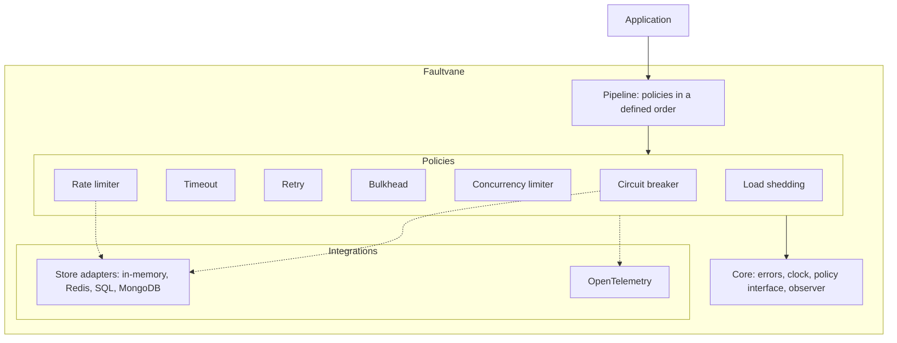
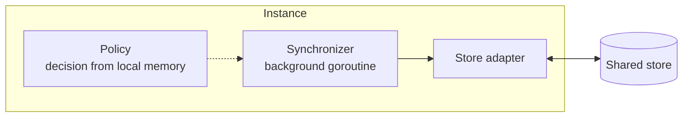

# Architecture

This document describes the architecture of the Faultvane toolkit.
Each policy has its own design documents. The [documentation index](README.md) lists them.

## 1. Layers



| Layer | Content | Dependencies |
|---|---|---|
| Core | Shared errors, the clock, the policy interface, the pipeline, the observer interface | Standard library |
| Policies | One package for each policy | Core |
| Store adapters | The connection of a policy to a shared store | Core, and the client library of the store |
| Observability | OpenTelemetry metrics and traces | Core, OpenTelemetry API |

A solid arrow is a required relation. A dotted arrow is an optional relation.

## 2. Design rules

1. **Each policy works alone.** A policy package does not import a different policy package.
2. **The policies combine.** Each policy implements one interface. A pipeline applies policies in the order that the application gives.
3. **Local first.** A policy makes each decision from local memory. A normal call does not use the network and does not allocate memory in the policy.
4. **Shared state is optional.** A policy with a shared store behaves as the same policy without a store when the store is not available.
5. **The core does not know a store product.** A policy that can share state defines a store interface. Adapters implement it.
6. **No required dependencies.** The core module uses only the standard library.
7. **Each goroutine has an owner.** A policy that starts a goroutine has a `Close` method that stops it.
8. **Each failure is visible.** A policy reports its decisions and its faults through the observer.

## 3. Policies

| Policy | Decision | State | Shared state |
|---|---|---|---|
| Circuit breaker | Reject calls while the dependency is unhealthy. | Circuit state and failure window | Optional. All instances share one circuit. |
| Timeout | Stop an attempt that takes too long. | None | No |
| Retry | Run a failed attempt again, within a budget. | Retry budget | No |
| Bulkhead | Reject calls above a fixed number of concurrent calls for one dependency. | Number of calls in progress | No. The resources that it protects are local. |
| Concurrency limiter | Adapt the limit of concurrent calls to the measured latency. | Limit and latency measurements | No |
| Rate limiter | Reject calls above a rate. | Tokens or counters | Under evaluation. A shared limit for all instances needs a store. |
| Load shedding | Reject low-priority work when the service is overloaded. | Load measurement | No. The overload is local. |

## 4. Policy model

All policies have the same shape.

```go
type Policy interface {
    Do(ctx context.Context, call func(context.Context) error) error
}
```

A typed helper runs a function that returns a value:

```go
func Execute[T any](ctx context.Context, policy Policy, call func(context.Context) (T, error)) (T, error)
```

A pipeline is also a policy:

```go
func Combine(policies ...Policy) Policy
```

The first policy of `Combine` is the outermost policy.

Rules for each policy:

| Rule | Statement |
|---|---|
| Rejection | A policy that does not run the call returns an error that matches `faultvane.ErrRejected`. Each policy has its own error below it. |
| Error of the call | A policy returns the error of the call without a change. |
| Context | A policy passes the context to the call. It obeys cancellation. |
| Panic | A policy records a panic of the call as a failure and then panics again. |
| Concurrency | All methods are safe for concurrent use. |
| Fast path | A policy can offer a direct API that is faster than the general interface. The circuit breaker offers `Allow` with a permit. |

This model is the planned model.
Milestone M1 fixes it together with the first policy.
The [policy composition](policy-composition.md) document defines the recommended order and the interaction rules.

## 5. Shared state

Some policies can coordinate the instances of a service.
The model is the same for each of them:



- The request path reads local memory only.
- A background synchronizer exchanges data with the store in batches.
- The store holds the authoritative state.
- When the store is not available, the policy uses its local state. This is local mode.
- When the store is available again, the policy reconciles. A local state never overwrites a newer authoritative state.

Each policy with shared state defines its own store interface, because each policy has different atomic operations.
An adapter module, for example the Redis adapter, implements the interfaces of the policies that it supports.
[Stores](stores/README.md) describes the interface of the circuit breaker and the contract of an adapter.

The circuit breaker is the first policy with shared state.
Its [architecture](circuit-breaker/architecture.md) is the reference for later policies.

## 6. Module layout

The repository contains one core module and separate modules for integrations.
An application gets the client library of a store only when it imports the adapter of that store.

```text
faultvane-go/
├── go.mod                   core module, standard library only
├── faultvane.go             shared errors, policy interface, pipeline
├── circuitbreaker/          circuit breaker
├── timeout/                 timeout
├── retry/                   retry
├── bulkhead/                bulkhead
├── concurrencylimit/        concurrency limiter
├── ratelimit/               rate limiter
├── loadshed/                load shedding
├── internal/                code that is not part of the public API
├── store/
│   ├── memory/              in-memory adapter, part of the core module
│   ├── storetest/           conformance suite, part of the core module
│   ├── redis/               separate module, depends on the Redis client
│   │   ├── go.mod
│   │   └── scripts/         Lua scripts, embedded in the binary
│   ├── sql/                 separate module, uses database/sql
│   │   └── go.mod
│   └── mongodb/             separate module, depends on the MongoDB driver
│       └── go.mod
├── otel/                    separate module, OpenTelemetry metrics and traces
│   └── go.mod
├── examples/                separate module, example applications
│   └── go.mod
├── tests/                   separate module, tests that need external libraries
│   └── go.mod
└── docs/
```

| Module | Path | Dependencies |
|---|---|---|
| Core | `github.com/faultvane/faultvane-go` | Standard library |
| Redis adapter | `github.com/faultvane/faultvane-go/store/redis` | Core, `github.com/redis/go-redis/v9` |
| SQL adapter | `github.com/faultvane/faultvane-go/store/sql` | Core, `database/sql` |
| MongoDB adapter | `github.com/faultvane/faultvane-go/store/mongodb` | Core, MongoDB Go driver |
| OpenTelemetry | `github.com/faultvane/faultvane-go/otel` | Core, OpenTelemetry API |

## 7. Observability

The core defines one observer interface for events.
Each policy reports its decisions, its state changes, and its faults.
Metric names have the form `faultvane_<policy>_<name>`.
Labels have a low and fixed cardinality.
The circuit breaker [observability](circuit-breaker/observability.md) document is the reference for later policies.

## 8. Related decisions

- [ADR 0005: One repository with a dependency-free core module](adr/0005-module-layout.md)
- [ADR 0006: Store interface with adapters](adr/0006-store-interface-and-adapters.md)
- The decisions for the circuit breaker are in ADR 0001 to ADR 0004.
