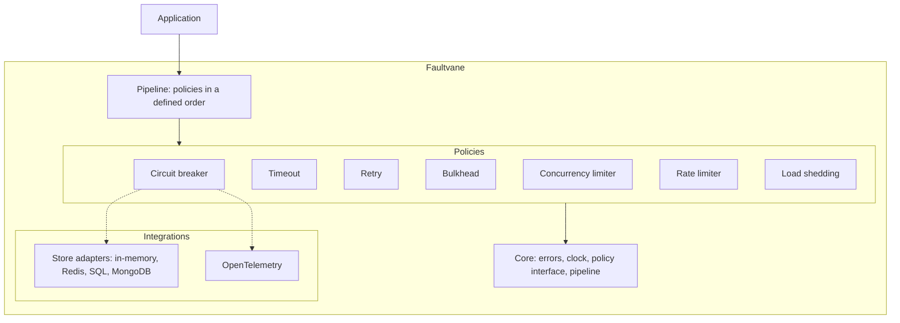
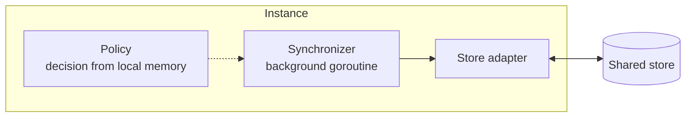

# Architecture

This document describes the architecture of the Faultvane toolkit.
Each policy has its own design documents. The [documentation index](README.md) lists them.

## 1. Layers



| Layer | Content | Dependencies |
|---|---|---|
| Core | Shared errors, the clock, the policy interface, the pipeline | Standard library |
| Policies | One package for each policy | Core |
| Store adapters | The connection of the circuit breaker to a shared store | Core, and the client library of the store |
| Observability | OpenTelemetry metrics and trace attributes for the circuit breaker | Core, OpenTelemetry API |

A solid arrow is a required relation. A dotted arrow is an optional relation.
Only the circuit breaker uses a store and the OpenTelemetry module.

## 2. Design rules

1. **Each policy works alone.** A policy package does not import a different policy package.
2. **The policies combine.** Each policy implements one interface. A pipeline applies policies in the order that the application gives.
3. **Local first.** A policy makes each decision from local memory. A normal call does not use the network and does not allocate memory in the policy. The timeout policy is the exception for memory: it makes a context with a deadline for each call. [Benchmarks](benchmarks.md) gives the number of allocations.
4. **Shared state is optional.** A policy with a shared store behaves as the same policy without a store when the store is not available.
5. **The core does not know a store product.** A policy that can share state defines a store interface. Adapters implement it.
6. **No required dependencies.** The core module uses only the standard library.
7. **Each goroutine has an owner.** A policy that starts a goroutine has a `Close` method that stops it. Only a circuit breaker with a store and a rate limiter with a store start a goroutine.
8. **Each failure is visible.** The circuit breaker reports its state changes and its faults through logs, an observer, and counters. The other policies do not have this function yet. Section 7 gives the status.

## 3. Policies

| Policy | Decision | State | Shared state |
|---|---|---|---|
| Circuit breaker | Reject calls while the dependency is unhealthy. | Circuit state and failure window | Optional. All instances share one circuit. |
| Timeout | Stop an attempt that takes too long. | None | No |
| Retry | Run a failed attempt again, within a budget. The option `retry.WithGate` connects the retry to a circuit breaker. | Retry budget | No |
| Bulkhead | Reject calls above a fixed number of concurrent calls for one dependency. | Number of calls in progress and number of waiting callers | No. The resources that it protects are local. |
| Concurrency limiter | Adapt the limit of concurrent calls to the results of the calls. | The limit and the number of calls in progress | No |
| Rate limiter | Reject calls above a rate. | The tokens of one token bucket | Optional. With a store, the instances share one token bucket. See the [rate limit store](ratelimit/store.md). |
| Load shedding | Reject low-priority work when the service is overloaded. | Number of calls in progress | No. The overload is local. |

Each policy has a guide. The [documentation index](README.md) lists the guides.

## 4. Policy model

All policies have the same shape.

```go
type Policy interface {
    Do(ctx context.Context, call func(context.Context) error) error
}
```

A typed helper runs a function that returns a value:

```go
func Execute[T any](ctx context.Context, policy Policy, call func(context.Context) (T, error)) (T, error)
```

A pipeline is also a policy:

```go
func Combine(policies ...Policy) Policy
```

The first policy of `Combine` is the outermost policy.

Rules for each policy:

| Rule | Statement |
|---|---|
| Rejection | A policy that does not run the call returns an error that matches `faultvane.ErrRejected`. Each policy has its own error below it. |
| Error of the call | A policy returns the error of the call without a change. The timeout policy is the one exception. When its time limit ends, it returns an error that matches `timeout.ErrTimeout` and also the error of the call. The [timeout guide](timeout/README.md) gives the rule. |
| Context | A policy passes the context to the call. It obeys cancellation. |
| Panic | A policy records a panic of the call as a failure and then panics again. |
| Concurrency | All methods are safe for concurrent use. |
| Fast path | A policy can offer a direct API that is faster than the general interface. The circuit breaker offers `Allow` with a permit. |

All seven policies implement this model.
The [policy composition](policy-composition.md) document defines the recommended order and the interaction rules.

## 5. Shared state

A policy can coordinate the instances of a service through a shared store.
Only the circuit breaker does this now.
The model is:



- The request path reads local memory only.
- A background synchronizer exchanges data with the store in batches.
- The store holds the authoritative state.
- When the store is not available, the policy uses its local state. This is local mode.
- When the store is available again, the policy reconciles. A local state never overwrites a newer authoritative state.

A policy with shared state defines its own store interface, because each policy has different atomic operations.
The circuit breaker defines the interface `circuitbreaker.Store`.
The adapter modules for Redis, SQL databases, and MongoDB implement it.
[Stores](stores/README.md) describes the interface and the contract of an adapter.

The circuit breaker and the rate limiter are the policies with shared state.
The circuit breaker [architecture](circuit-breaker/architecture.md) is the reference for a policy with shared state. The rate limiter has its own store interface. See the [rate limit store](ratelimit/store.md).

## 6. Module layout

The repository contains one core module and separate modules for integrations.
An application gets the client library of a store only when it imports the adapter of that store.

```text
faultvane-go/
├── go.mod                   core module, standard library only
├── faultvane.go             shared errors
├── policy.go                policy interface, pipeline, Execute
├── clock.go                 clock interface and system clock
├── faultvanetest/           clock that a test controls
├── circuitbreaker/          circuit breaker, Store interface, Record, in-memory store
│   └── storetest/           conformance suite for store adapters
├── timeout/                 timeout
├── retry/                   retry
├── bulkhead/                bulkhead
├── concurrencylimit/        concurrency limiter
├── ratelimit/               rate limiter
├── loadshed/                load shedding
├── store/
│   ├── redis/               separate module, depends on the Redis client
│   │   ├── go.mod
│   │   └── scripts/         Lua scripts, embedded in the binary
│   ├── sql/                 separate module, uses database/sql
│   │   └── go.mod
│   └── mongodb/             separate module, depends on the MongoDB driver
│       └── go.mod
├── otel/                    separate module, OpenTelemetry metrics and trace attributes
│   └── go.mod
├── examples/                separate module, three example programs with tests
│   ├── go.mod
│   ├── pipeline/            four policies in one pipeline
│   └── shared/              five instances that share one circuit through Redis
├── scripts/                 coverage check, traceability check, store tests
├── docker-compose.test.yml  the stores for the tests
└── docs/
```

The in-memory store and the conformance suite are part of the core module.
The directory `store/` contains only the adapters that need a client library.

| Module | Path | Package name | Minimum Go version | Dependencies |
|---|---|---|---|---|
| Core | `github.com/faultvane/faultvane-go` | `faultvane` and one package for each policy | 1.24 | Standard library |
| Redis adapter | `github.com/faultvane/faultvane-go/store/redis` | `redisstore` | 1.26 | Core, `github.com/redis/go-redis/v9` |
| SQL adapter | `github.com/faultvane/faultvane-go/store/sql` | `sqlstore` | 1.25 | Core, `database/sql`. The tests use the drivers `pgx` and `go-sql-driver/mysql`. |
| MongoDB adapter | `github.com/faultvane/faultvane-go/store/mongodb` | `mongostore` | 1.25 | Core, `go.mongodb.org/mongo-driver/v2` |
| OpenTelemetry | `github.com/faultvane/faultvane-go/otel` | `faultvaneotel` | 1.26 | Core, OpenTelemetry API |
| Examples | `github.com/faultvane/faultvane-go/examples` | `main` | 1.26 | Core, Redis adapter |

Each separate module has a `replace` directive that points to the core in the same repository.
A release must give a tag to each module. No release tag exists yet.

## 7. Observability

The circuit breaker is the only policy with observability now.

| Signal | Source |
|---|---|
| Logs | The package `circuitbreaker` writes state changes and faults with `log/slog`. |
| Events | The interface `circuitbreaker.Observer` receives state changes, mode changes, reconciliations, and store faults. |
| Counters | `Breaker.Stats` returns the counters of one breaker. |
| Metrics | The module `otel` exports the counters as OpenTelemetry metrics. The names start with `faultvane.circuit_breaker.`. |
| Traces | `faultvaneotel.Traced` adds attributes to the active span. |

The attributes have a low and fixed cardinality.
The circuit breaker [observability](circuit-breaker/observability.md) document gives the names.

The timeout, retry, bulkhead, concurrency limiter, rate limiter, and load shedding policies have statistics (`Stats`) and OpenTelemetry metrics. They write no logs and have no observer.
The core package defines no observer interface.
The bulkhead, the concurrency limiter, and the load shedding policy have methods that return their current numbers, for example `InFlight`. The guide of each policy lists them.

## 8. Related decisions

- [ADR 0005: One repository with a dependency-free core module](adr/0005-module-layout.md)
- [ADR 0006: Store interface with adapters](adr/0006-store-interface-and-adapters.md)
- [ADR 0007: One exported record type for the adapters written in Go](adr/0007-shared-record-for-go-adapters.md)
- The decisions for the circuit breaker are in ADR 0001 to ADR 0004.
