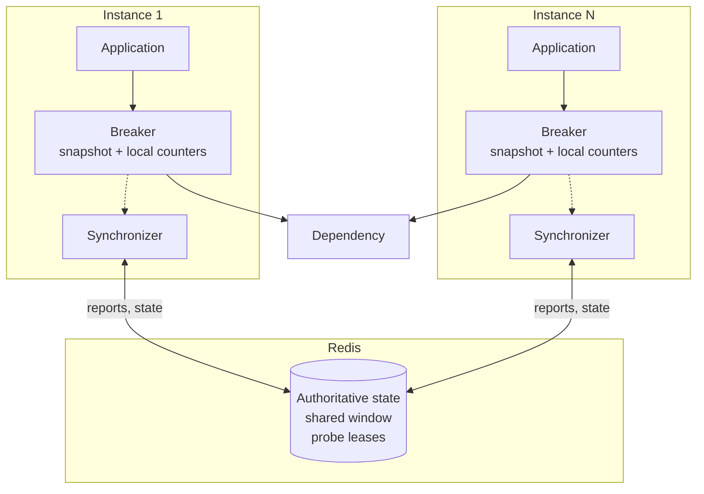
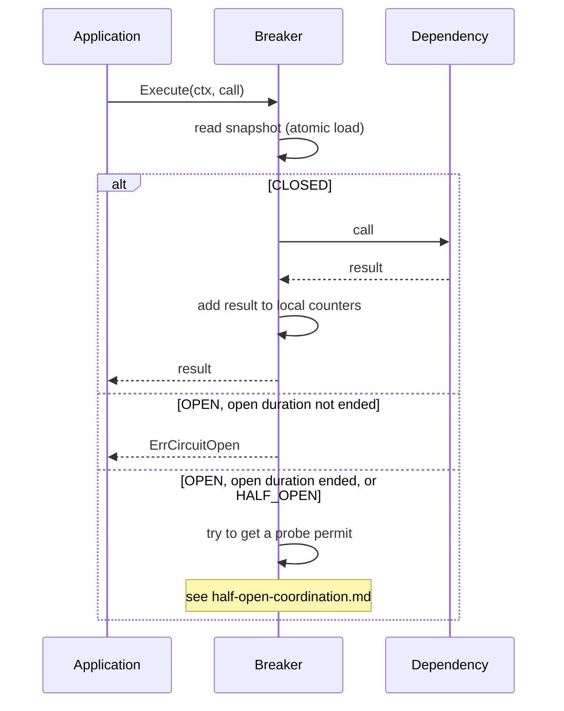
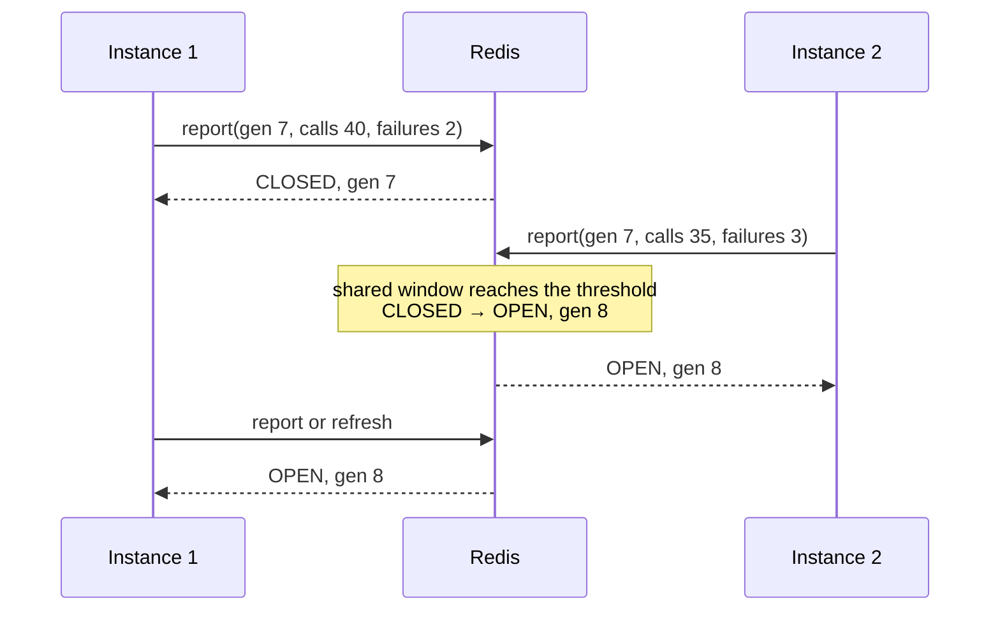
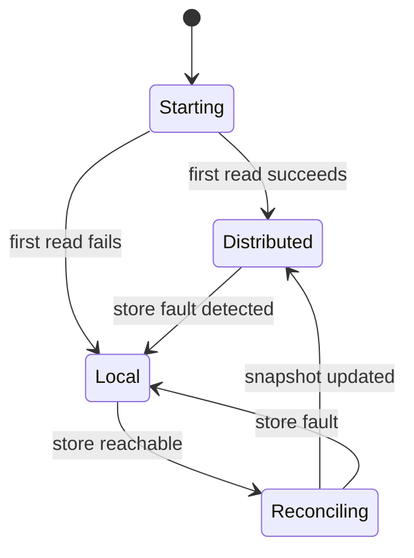

# Architecture

## 1. Overview

Each instance holds a snapshot of the authoritative state in memory.
The request path reads only this snapshot.
A background task, the synchronizer, exchanges data with Redis.



The design has three rules:

1. **Redis is the source of truth.** A local state never replaces a newer authoritative state.
2. **The request path is local.** A call in the `CLOSED` state reads memory and updates counters. It does not use the network.
3. **Redis is not necessary for operation.** Without Redis, each instance runs a local breaker for a limited time.

## 2. Components

| Component | Responsibility |
|---|---|
| State machine | Pure functions that calculate the next state from the current state and an event. No I/O. |
| Window | Lock-free counters of calls, failures, and slow calls in time buckets. |
| Breaker | The public type. It makes the permit decision from the snapshot and records results. |
| Synchronizer | One background goroutine for each store. It sends reports, refreshes snapshots, and detects store faults. |
| Store | The interface to the shared state. It hides Redis from the breaker. |
| Redis store | The store implementation. It runs the atomic scripts. |
| Observer | The interface for metrics, logs, and traces. |

The state machine and the window do not know about the store.
The same state machine runs in distributed mode and in local mode.

## 3. Request path



The `CLOSED` path and the `OPEN` path do these operations only:

- One atomic load of the snapshot.
- Atomic additions to the counters of the current bucket.
- Two reads of the monotonic clock, to measure the call duration.

These paths take no lock, allocate no memory, and do not call Redis.

Only a probe attempt calls Redis from the request path.
A probe attempt has a strict timeout.
At most one probe attempt runs in each instance at one time.
All other calls in that instance get an immediate rejection.

## 4. Synchronization

The synchronizer sends a report for each breaker.
A report contains the number of calls, failures, and slow calls since the last report, and the generation in which the instance recorded them.

Redis adds the report to the shared window in one atomic script.
The same script evaluates the failure condition and makes the transition to `OPEN`.
The script returns the current authoritative state.
The instance replaces its snapshot with this state.



The synchronizer runs at these times:

| Trigger | Default | Purpose |
|---|---|---|
| Sync interval | 500 ms | Send the counts and refresh the snapshot. |
| A recorded failure | At most one early report each 50 ms | Detect an outage quickly. |
| A transition notification | Optional, through Redis Pub/Sub | Make the propagation faster. Correctness does not depend on it. |

All breakers of one store share one synchronizer goroutine.
The synchronizer sends the reports of one cycle in one pipeline.

### Limits that result from this design

- **Detection delay.** The circuit opens at most one early-report interval after the shared window reaches the threshold.
- **Propagation delay.** The other instances observe `OPEN` at most one sync interval later.
- **Overshoot.** During the propagation delay, an instance can still send calls to the dependency. The sync interval sets the limit of this overshoot.
- **Redis load.** The maximum is one report for each instance and breaker in each early-report interval. With the defaults, 100 instances make at most 2000 small operations each second for a breaker that fails, and 200 for a healthy breaker.

## 5. Time

Clocks of different instances are not equal.
For this reason, all times in the authoritative state come from the Redis server clock.
The scripts read the time with the `TIME` command.

Each response from Redis contains the Redis time.
The instance calculates the difference between the Redis clock and its monotonic clock.
With this difference, the instance knows locally when the open duration ends.

In local mode, the instance uses only its monotonic clock and durations.

## 6. Modes



[Degraded mode](circuit-breaker/degraded-mode.md) describes local mode and reconciliation.

## 7. Module layout

The repository contains one core module and separate modules for integrations.
The core module has no dependencies outside the standard library.
An application that uses only local policies does not get a Redis client as a dependency.

```text
faultvane-go/
├── go.mod                   core module, standard library only
├── faultvane.go             shared errors, events, clock, policy interface
├── circuitbreaker/          breaker, state machine, window, store interface
├── timeout/
├── retry/
├── bulkhead/
├── concurrencylimit/
├── ratelimit/
├── loadshed/
├── internal/                code that is not part of the public API
├── store/
│   └── redis/               separate module, depends on the Redis client
│       ├── go.mod
│       └── scripts/         Lua scripts, embedded in the binary
├── otel/                    separate module, OpenTelemetry metrics and traces
│   └── go.mod
├── examples/                separate module, example applications
│   └── go.mod
├── tests/                   separate module, tests that need external libraries
│   └── go.mod
└── docs/
```

| Module | Path | Dependencies |
|---|---|---|
| Core | `github.com/faultvane/faultvane-go` | Standard library |
| Redis store | `github.com/faultvane/faultvane-go/store/redis` | Core, `github.com/redis/go-redis/v9` |
| OpenTelemetry | `github.com/faultvane/faultvane-go/otel` | Core, OpenTelemetry API |

The module path is an assumption until the project has a repository host.
A change of the module path is cheap before the first release and expensive after it.

## 8. Concurrency model

| Data | Protection |
|---|---|
| Snapshot | `atomic.Pointer` to an immutable value. The synchronizer replaces the pointer. |
| Window buckets | Atomic counters. |
| Probe attempt in progress | One atomic flag for each breaker. |
| Synchronizer state | Owned by the synchronizer goroutine only. |

The breaker has no mutex on the request path.

Each store owns one synchronizer goroutine.
`Close` stops the goroutine and sends the last report with a time limit.
Tests use a goroutine leak detector.

## 9. Related decisions

- [ADR 0001: Local decisions with batched shared aggregation](adr/0001-local-decision-shared-aggregation.md)
- [ADR 0002: Atomic transitions in Lua scripts with a generation](adr/0002-lua-scripts-and-generation.md)
- [ADR 0003: Redis server time for all shared timestamps](adr/0003-redis-server-time.md)
- [ADR 0004: Local breaker as the fallback](adr/0004-local-breaker-fallback.md)
- [ADR 0005: One repository with a dependency-free core module](adr/0005-module-layout.md)
