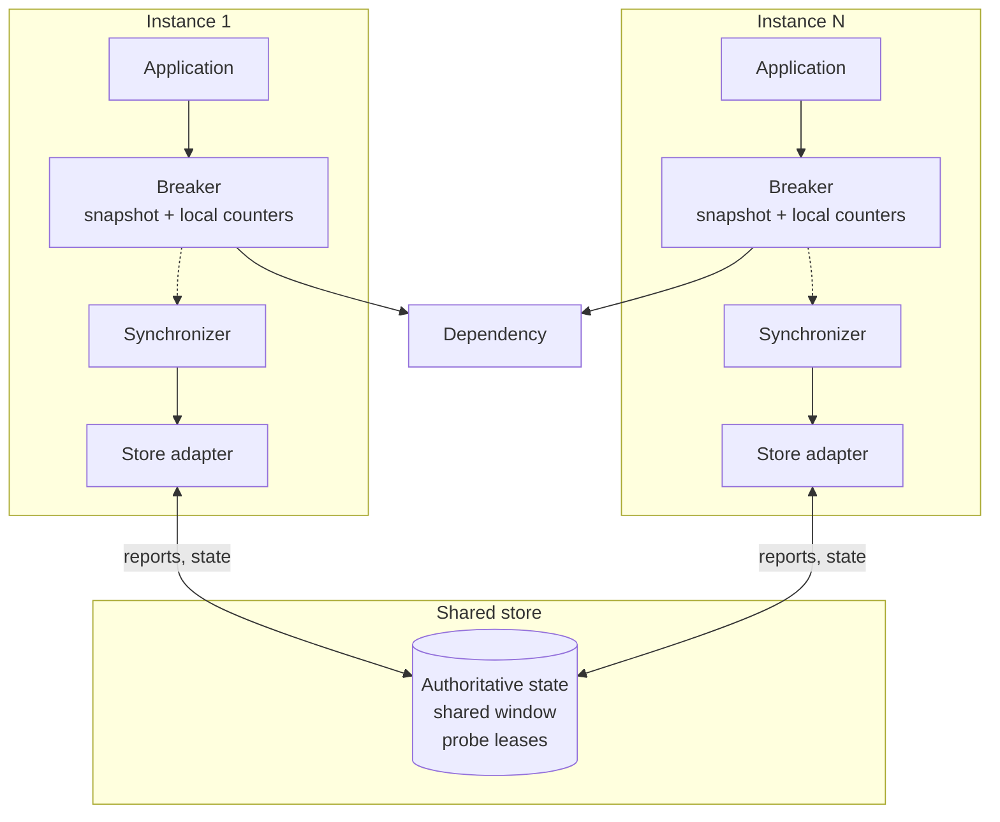
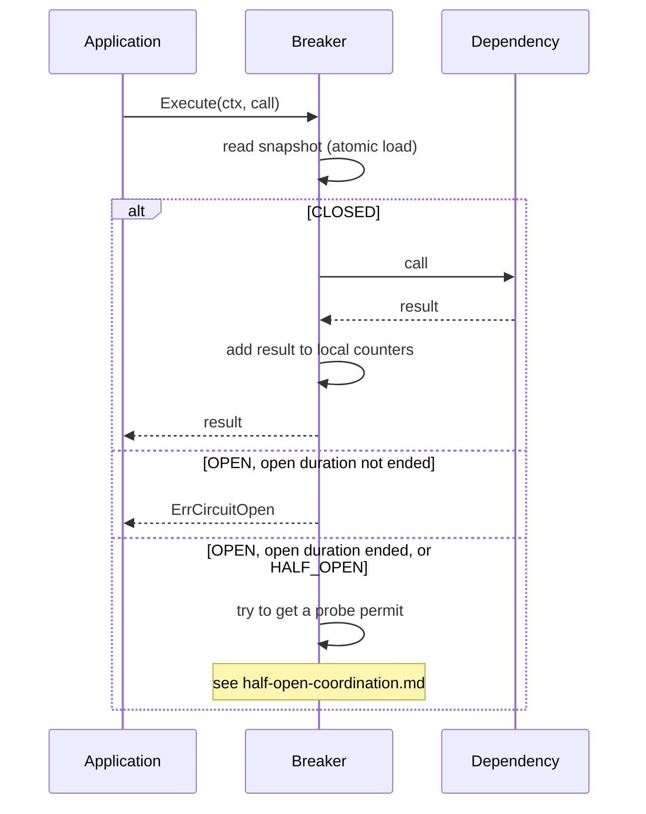
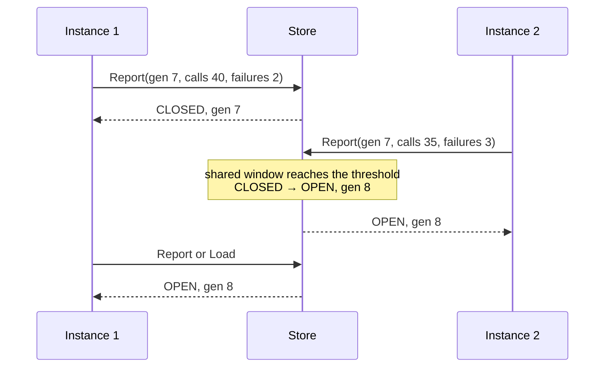
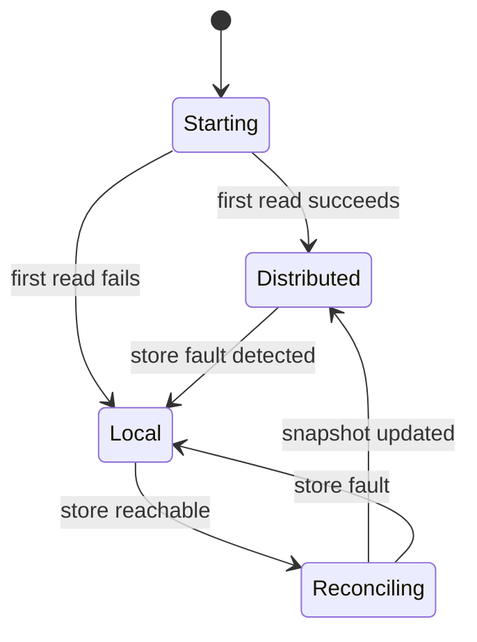

# Circuit breaker architecture

This document describes the architecture of the circuit breaker.
The [toolkit architecture](../architecture.md) describes the layers and the module layout of Faultvane.

## 1. Overview

Each instance holds a snapshot of the authoritative state in memory.
The request path reads only this snapshot.
A background task, the synchronizer, exchanges data with the shared store.

The store can be Redis, a SQL database, MongoDB, or another system.
The breaker uses it through an adapter.

The design has four rules:

1. **The store is the source of truth.** A local state never replaces a newer authoritative state.
2. **The request path is local.** A call in the `CLOSED` state reads memory and updates counters. It does not use the network.
3. **The store is not necessary for operation.** Without the store, each instance runs a local breaker for a limited time.
4. **The store is replaceable.** The core does not know the type of the store. All behavior that is not storage is in the core.

## 2. Components

| Component | Responsibility | Location |
|---|---|---|
| State machine | The pure type `Record` and the type `Thresholds`. Their methods calculate the next state from the current state and an event. No I/O. | `circuitbreaker/record.go`, `thresholds.go` |
| Window | Lock-free counters of calls, failures, and slow calls in time buckets. | `circuitbreaker/window.go` |
| Breaker | The public type. It makes the permit decision from the snapshot and records results. | `circuitbreaker/breaker.go`, `permit.go` |
| Synchronizer | One background goroutine for each breaker that has a store. It sends reports, refreshes the snapshot, detects store faults, and reconciles. | `circuitbreaker/sync.go` |
| Store interface | Five operations on the shared state. | `circuitbreaker/store.go` |
| Store adapter | The implementation of the interface for one type of store. | `circuitbreaker/store.go` for in-memory, the modules `store/redis`, `store/sql`, and `store/mongodb` for the others |
| Conformance suite | The tests that each adapter must pass. | `circuitbreaker/storetest` |
| Observer, counters, logs | The interface for events, the counters of `Stats`, and the logs with `log/slog`. | `circuitbreaker/observe.go` |
| Metrics and trace attributes | The export of the counters to OpenTelemetry. | The module `otel` |

The state machine and the window do not know about the store.
The same state machine runs in distributed mode and in local mode.
[Stores](../stores/README.md) defines the interface and the contract of an adapter.

## 3. Request path

The `CLOSED` path and the `OPEN` path do these operations only:

- One atomic load of the snapshot.
- Atomic additions to the counters of the current bucket.
- Two reads of the monotonic clock, to measure the call duration.

These paths take no lock, allocate no memory, and do not call the store.
[Benchmarks](../benchmarks.md) gives the measured time.

Only a probe attempt calls the store from the request path.
A probe attempt has a strict timeout.
At most one probe attempt runs in each instance at one time.
All other calls in that instance get an immediate rejection.

## 4. Synchronization

The synchronizer sends a report for its breaker.
A report contains the number of calls, failures, and slow calls since the last report, and the generation in which the instance recorded them.
It also contains the thresholds, the window settings, the open duration, and the state TTL of the instance.
When the instance has no new counts, the synchronizer reads the state with `Load`.

The store adds the report to the shared window in one atomic operation.
The same operation evaluates the failure condition and makes the transition to `OPEN`.
The operation returns the current authoritative state.
The instance replaces its snapshot with this state.

The synchronizer runs at these times:

| Trigger | Default | Purpose |
|---|---|---|
| Sync interval | 500 ms | Send the counts and refresh the snapshot. |
| A recorded failure | At most one early report each 50 ms | Detect an outage quickly. |

No adapter has a faster propagation, for example a notification of each transition. That function is not implemented.
The sync interval gives the propagation.

### Limits that result from this design

- **Detection delay.** The circuit opens at most one early-report interval after the shared window reaches the threshold.
- **Propagation delay.** The other instances observe `OPEN` at most one sync interval later.
- **Overshoot.** During the propagation delay, an instance can still send calls to the dependency. The sync interval sets the limit of this overshoot.
- **Store load.** The maximum is one report for each instance and breaker in each early-report interval. With the defaults, 100 instances make at most 2000 small operations each second for a breaker that fails, and 200 for a healthy breaker.

The store load does not depend on the request rate of the application.
The system benchmark measured approximately 2 store operations each second for each instance, at a low and at a high request rate. [Benchmarks](../benchmarks.md) gives the results.
The latency of a store operation sets the lowest practical sync interval for that store.

## 5. Time

Clocks of different instances are not equal.
For this reason, all times in the authoritative state come from one clock: the clock of the store.
The Redis adapter uses the Redis server time. The SQL adapter uses the time of the database server. The MongoDB adapter uses the time of the MongoDB server.

Each response from the store contains the store time.
From the transition time, the open duration, and the store time, the instance calculates the remaining open duration.
It adds this duration to the time of its own clock.
The instance then knows locally when the open duration ends, and the difference between the clocks has no effect.

In local mode, the instance uses only its own clock and durations.

## 6. Modes

[Degraded mode](degraded-mode.md) describes local mode and reconciliation.
The core implements both. They work the same with each adapter.

## 7. Concurrency model

| Data | Protection |
|---|---|
| Snapshot | `atomic.Pointer` to an immutable value. A change of state replaces the pointer. |
| Window buckets, pending counts, counters of `Stats` | Atomic counters. |
| Probe attempt in progress | One atomic flag for each breaker. |
| Local record, last authoritative snapshot, count of store faults | One mutex for each breaker. |
| One synchronization at a time | A second mutex. `Close` and the synchronizer goroutine use it. |

The `CLOSED` path and the `OPEN` path take no mutex.
The request path takes the mutex only for a probe, for a local transition, and after a store fault.

Each breaker with a store owns one synchronizer goroutine.
`Close` stops the goroutine and sends the last report with a time limit.
A breaker without a store starts no goroutine.
Tests compare the number of goroutines before and after.

An application has a small and fixed number of breakers, so one goroutine for each breaker is cheap.
A shared synchronizer that sends the reports of many breakers in one batch is a possible optimization.
It needs a measurement that shows a benefit first.

## 8. Related decisions

- [ADR 0001: Local decisions with batched shared aggregation](../adr/0001-local-decision-shared-aggregation.md)
- [ADR 0002: Atomic transitions in Lua scripts with a generation](../adr/0002-lua-scripts-and-generation.md)
- [ADR 0003: Redis server time for all shared timestamps](../adr/0003-redis-server-time.md)
- [ADR 0004: Local breaker as the fallback](../adr/0004-local-breaker-fallback.md)
- [ADR 0005: One repository with a dependency-free core module](../adr/0005-module-layout.md)
- [ADR 0006: Store interface with adapters](../adr/0006-store-interface-and-adapters.md)
- [ADR 0007: One exported record type for the adapters written in Go](../adr/0007-shared-record-for-go-adapters.md)
