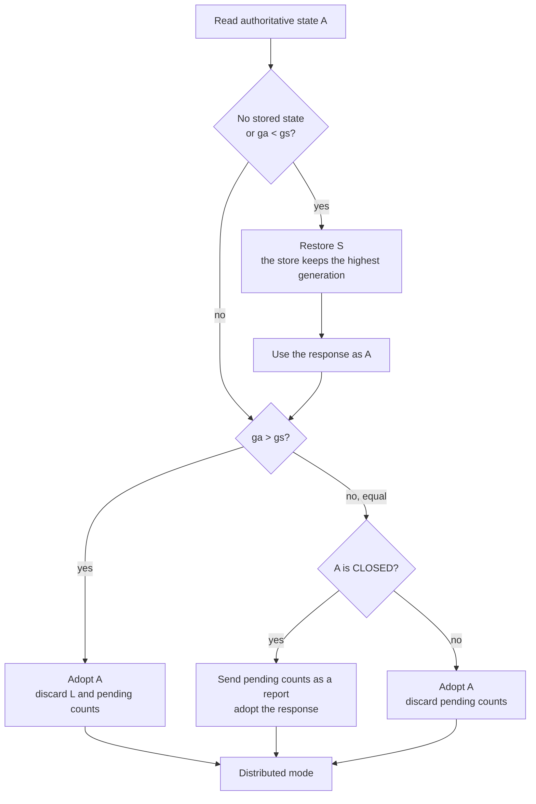

# Degraded mode and reconciliation

The store must not become a single point of failure.
When an instance cannot reach the store, it changes to **local mode**.
In local mode, the instance runs a local breaker.
When the store is reachable again, the instance **reconciles** and returns to distributed mode.

## 1. Detection of a store fault

Each store operation has a strict timeout. The default is 100 ms.
An error or a timeout is a store fault.

The instance changes to local mode after 3 store faults in sequence.
This number is configurable.

In local mode, the synchronizer sends a health check with exponential backoff and jitter.
The backoff starts at 250 ms and has a maximum of 5 seconds.
Only the synchronizer goroutine sends health checks.
The request path does not call the store in local mode, and it does not wait for the store.

The results are:

- A store fault never blocks an application request for longer than one store timeout. Only a probe attempt can wait for that time.
- The number of store operations during an outage has a limit. There is no retry storm.

## 2. Behavior in local mode

When the instance enters local mode, its local state starts from the last snapshot.

| Last snapshot | Local behavior |
|---|---|
| `CLOSED` | The instance evaluates the failure condition on its local window. It can open its local circuit. |
| `OPEN` | The instance stays `OPEN` until the open duration ends. Then it changes to a local `HALF_OPEN`. |
| `HALF_OPEN` | A probe with a lease continues. Its result applies to the local state. Other calls use the local probe limit. |

The local window already contains the recent calls of the instance, because the request path always writes to it.
The change to local mode loses no local data.

### Thresholds in local mode

In local mode, one instance sees only its own part of the traffic.
A failure count threshold that fits the sum of all instances can be too high for one instance.
The rate thresholds do not have this problem.

For this reason, local mode has two optional overrides: `LocalFailureThreshold` and `LocalMinimumCalls`.
Without an override, local mode uses the normal values.

### Generation in local mode

A local transition does not change the generation.
The instance keeps the generation of its last snapshot.
The local state is never an authoritative state, and it is never the input of `Restore`.

## 3. Time limit of local mode

`MaxLocalFallbackDuration` is the maximum time in local mode. The default is 5 minutes.
After this time, the instance applies the `LocalModeExpiredPolicy`:

| Policy | Behavior | Use |
|---|---|---|
| `KeepLocalBreaker` (default) | The local breaker continues. The instance logs an error and sets a metric. | The store is an aid. A long store outage must not stop the application. |
| `RejectAll` | The breaker rejects all calls. | The dependency is fragile. Uncoordinated traffic is worse than no traffic. |
| `AllowAll` | The breaker permits all calls and does not record results. | The call has its own protection. |

The default continues to protect the dependency, and it does not make the store a single point of failure.
The local state stays a non-authoritative state under each policy.

## 4. Start without a store connection

An instance that starts has no snapshot and no local state.
It reads the authoritative state with a time limit.
If the read fails, the `StartPolicy` applies:

| Policy | Behavior |
|---|---|
| `StartWithProbe` (default) | The local breaker starts in `HALF_OPEN`. The first call is a probe. A success closes the local circuit. A failure opens it. |
| `StartClosed` | The local breaker starts in `CLOSED`. |
| `StartRejecting` | The breaker rejects all calls until the first successful read. |

The default does not assume that the dependency is healthy.
It sends one call to find out.

## 5. Reconciliation

Reconciliation starts when a health check succeeds.
Each instance waits a random time, up to one sync interval, before it starts.
This prevents a burst of operations on a store that just recovered.

The instance has these values:

- **S**: its last snapshot, with generation `gs`.
- **L**: its local state.
- **A**: the authoritative state that it reads now, with generation `ga`.

Rules:

1. **The instance always adopts the authoritative state.** After reconciliation, the snapshot is the response from the store.
2. **The instance never writes its local state.** No operation copies L to the store.
3. **The instance adds only evidence.** When the generation did not change and the authoritative state is `CLOSED`, the instance sends the pending counts that are still in the window. This is a normal report. The store evaluates the failure condition on the sum of all reports.
4. **Only a probe closes a circuit.** A local `CLOSED` state has no effect on an authoritative `OPEN` or `HALF_OPEN` state.
5. **Only `Restore` writes a full state, and only an authoritative snapshot.** The store accepts it only when its generation is higher than the stored generation.

### Examples

| Authoritative state | Local state | Result |
|---|---|---|
| `OPEN`, generation 200 | `CLOSED`, snapshot generation 197 | The instance adopts `OPEN`, generation 200. The store does not change. |
| `CLOSED`, generation 57 | `OPEN`, snapshot generation 57 | The instance sends its pending counts. If the shared window now satisfies the failure condition, the store makes T1 and all instances get `OPEN`, generation 58. If not, the instance adopts `CLOSED`. |
| `CLOSED`, generation 57 | `CLOSED`, snapshot generation 57 | The instance sends its pending counts and continues. |
| No stored state | Snapshot `OPEN`, generation 90 | The instance calls `Restore`. The store holds `OPEN`, generation 90 again. If the open duration ended, the next call requests a probe. |

### Convergence

After reconciliation, each instance holds the authoritative state.
The authoritative state changes only through atomic operations in a total order.
The result does not depend on the order in which the instances reconcile, except for the order of their reports, and each report is a valid input of the same state machine.
No split-brain condition stays.

### No flapping

Reconciliation makes at most one transition, T1, and only when the shared evidence satisfies the failure condition.
A local `OPEN` state does not open the shared circuit directly.
A local `CLOSED` state does not close it.

## 6. Consistency model

| Mode | Guarantee |
|---|---|
| Distributed mode | One authoritative state. All transitions have a total order. Each instance observes a transition at most one sync interval later. The probe limit applies to all instances together. |
| Local mode | Each instance has its own state. States can be different. Each instance still protects the dependency with its local breaker. The probe limit applies to each instance separately. |
| Reconciliation | All instances converge to the authoritative state. A local state never overwrites it. |

The trade-off in local mode is clear:
the library keeps the application available and gives up the coordination between instances.
It never gives up the correctness of the authoritative state.

## 7. Network partition

A partition can separate some instances from the store while their connection to the dependency works.

| Topic | Behavior |
|---|---|
| Instances that cannot reach the store | They use local mode. |
| Instances that can reach the store | They continue in distributed mode. They do not see the calls of the other group. |
| Leases of instances that cannot reach the store | The leases end at their end time. |
| End of the partition | The separated instances reconcile. The authoritative state wins. |

A partition does not cause retries without a limit, blocked request goroutines, latency without a limit, or a write of a stale state.

## 8. Fault matrix

| Fault | Detection | Behavior |
|---|---|---|
| The store is down | Connection error | Local mode after the fault threshold. |
| The store is slow | Store timeout | The same as a store that is down. The request path does not wait. |
| The store restarts with data loss | Generation lower than the snapshot, or no stored state | `Restore` with the highest authoritative snapshot. |
| The store fails over | Errors during the failover, possibly an older generation after it | Local mode during the failover, then reconciliation and `Restore` when necessary. |
| Application restart | No snapshot | Read the authoritative state. If the read fails, apply the start policy. |
| Dependency down | Failure condition | T1 to `OPEN`. |
| Dependency recovers | Probe success | T3 to `CLOSED`. |
