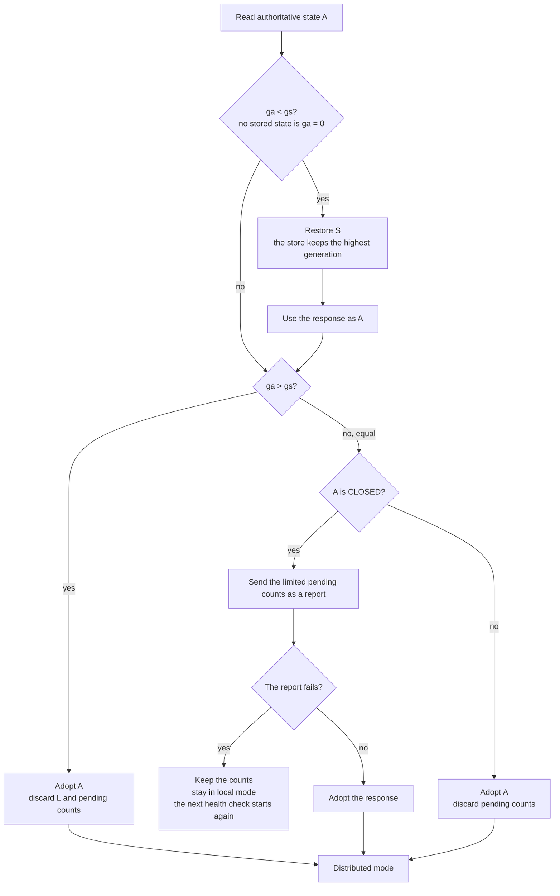

# Degraded mode and reconciliation

The store must not become a single point of failure.
When an instance cannot reach the store, it changes to **local mode**.
In local mode, the instance runs a local breaker.
When the store is reachable again, the instance **reconciles** and returns to distributed mode.

## 1. Detection of a store fault

Each store operation has a strict timeout. The default is 100 ms.
An error or a timeout is a store fault.

The instance changes to local mode after 3 store faults in sequence.
A successful store operation sets the count back to 0.
The option `WithFaultThreshold` sets this number.

In local mode, the synchronizer sends a health check at an interval that increases.
A health check is a read of the authoritative state.

- The wait before a health check has an upper limit. The limit starts at half of the sync interval.
- After each health check, the limit doubles, up to 10 times the sync interval.
- Each wait is a random time between half of the limit and the limit.

With the default sync interval of 500 ms, the limit starts at 250 ms and has a maximum of 5 seconds.

Only the synchronizer goroutine sends health checks.
A transition notification does not cause a health check. An instance in local mode ignores notifications.
The request path does not request a probe from the store in local mode, and it does not wait for the store.

The results are:

- A store fault never blocks an application request for longer than one store timeout. Only two operations can wait for that time: a probe request before the call, and the result of a probe after the call.
- The number of store operations during an outage has a limit. There is no retry storm.

## 2. Behavior in local mode

When the instance enters local mode, its local state starts from the last snapshot.

| Last snapshot | Local behavior |
|---|---|
| `CLOSED` | The instance evaluates the failure condition on its local window. It can open its local circuit. |
| `OPEN` | The instance stays `OPEN` until the open duration ends. Then it changes to a local `HALF_OPEN`. |
| `HALF_OPEN` | The instance starts a local `HALF_OPEN` state with no leases. New calls use the local probe limit. A probe that holds a lease from the store loses its result. See below. |

The local window already contains the recent calls of the instance, because the request path always writes to it.
The change to local mode loses no local data.
The pending counts stay also. They contain the counts of the reports that failed before the change (FD-9). Section 5 describes how the reconciliation sends them.

### A probe that holds a lease from the store

A call can hold a probe lease from the store at the time when its instance changes to local mode.
When that call ends, the instance sends its result to the store, with the store timeout as the limit.
The result does not go to the local state.

- When the store does not answer, the result is lost. The lease in the store ends at its end time.
- The local `HALF_OPEN` state has its own leases. The next call gets a local probe and tests the dependency again.

### Thresholds in local mode

In local mode, one instance sees only its own part of the traffic.
A failure count threshold that fits the sum of all instances can be too high for one instance.
The rate thresholds do not have this problem.

For this reason, local mode has two optional overrides: `WithLocalFailureThreshold` and `WithLocalMinimumCalls`.
Without an override, local mode uses the normal values.

### Generation in local mode

The instance keeps its last authoritative snapshot separately from its local state.
A local transition increases only the generation of the local state.
It does not change the last authoritative snapshot, and no operation sends the local generation to the store.
Reconciliation uses the generation of the last authoritative snapshot.
The local state is never an authoritative state, and it is never the input of `Restore`.

`State` and the events show the local state and the local generation while the instance is in local mode.

## 3. Time limit of local mode

`WithMaxLocalFallbackDuration` sets the maximum time in local mode. The default is 5 minutes.
The synchronizer examines this time before each health check.
After this time, the instance applies the policy of `WithLocalModeExpiredPolicy`:

| Policy | Behavior | Use |
|---|---|---|
| `KeepLocalBreaker` (default) | The local breaker continues. The instance logs an error and sets `LocalModeExpired` in `Stats`. | The store is an aid. A long store outage must not stop the application. |
| `RejectAll` | The breaker rejects all calls with `ErrCircuitOpen`. | The dependency is fragile. Uncoordinated traffic is worse than no traffic. |
| `AllowAll` | The breaker permits all calls and does not record results. | The call has its own protection. |

The default continues to protect the dependency, and it does not make the store a single point of failure.
The local state stays a non-authoritative state under each policy.
Each policy logs the error and sets `LocalModeExpired`. The health checks continue under each policy.

With `WithLocalFallback(false)`, the instance applies the policy immediately when it changes to local mode.

## 4. Start without a store connection

An instance that starts has no snapshot and no local state.
It reads the authoritative state with a time limit.
If the read fails, the `StartPolicy` applies:

| Policy | Behavior |
|---|---|
| `StartWithProbe` (default) | The local breaker starts in `HALF_OPEN`. The first call is a probe. A success closes the local circuit. A failure opens it. |
| `StartClosed` | The local breaker starts in `CLOSED`. |
| `StartRejecting` | The breaker rejects all calls until the first successful read. |

The default does not assume that the dependency is healthy.
It sends one call to find out.

## 5. Reconciliation

Reconciliation starts when a health check succeeds.
The health check is the first step of the reconciliation: its response is the authoritative state A.
The instance does not wait before the next steps.
The random wait before each health check spreads the reconciliations of many instances in time.

The instance has these values:

- **S**: its last snapshot, with generation `gs`.
- **L**: its local state.
- **A**: the authoritative state that it reads now, with generation `ga`.

Rules:

1. **The instance always adopts the authoritative state.** After reconciliation, the snapshot is the response from the store.
2. **The instance never writes its local state.** No operation copies L to the store.
3. **The instance adds only evidence.** When the generation did not change and the authoritative state is `CLOSED`, the instance sends its pending counts. It limits each count to the total that is still in its last local `CLOSED` window. Older counts are not sent. This is a normal report. The store evaluates the failure condition on the sum of all reports. When the limited counts are 0, the instance sends no report.
4. **Only a probe closes a circuit.** A local `CLOSED` state has no effect on an authoritative `OPEN` or `HALF_OPEN` state.
5. **Only `Restore` writes a full state, and only an authoritative snapshot.** The store accepts it only when its generation is higher than the stored generation.
6. **A failed report of a reconciliation is sent again (RC-7).** When the report of rule 3 fails, the instance stays in local mode and puts the counts of the report back into its pending counts. The next successful health check starts the reconciliation again. Rule 3 then applies again to the pending counts, with the same limits.

### A failed report of a reconciliation

The health check and the report of one reconciliation share one store timeout.
The report can fail although the health check was successful.

Without rule 6, the counts of that report are lost. The instance then adopts `CLOSED` at the next health check, although the instances together had sufficient failures. The state after the outage then depends on the delivery of one report. That is against requirement RC-4.

Rule 6 has a cost. The instance does not know if the store added the counts of a failed report. When the store added them and the response did not arrive, the next report adds the same counts a second time.

- The error is in the safe direction. The shared circuit can open too early. It cannot stay `CLOSED` because of lost counts. A circuit that opened too early closes after one successful probe.
- Each report has the limit of rule 3. One report that is counted two times adds at most the totals of one local window of one instance. Example: an instance has 3 failures in its local window. The shared window then gets at most 6 failures from this instance, not 3.
- Each more response that does not arrive adds the same limit one more time. The interval between health checks limits the number of reports in one window.
- The counts that are too high leave the shared window after one window size.
- When the first report opened the circuit, the generation changed. The instance then discards its counts and sends no second report. The store also ignores a report with an old generation.
- A rate does not change when the calls and the failures of one instance are counted two times. The failure count and the minimum number of calls are reached earlier.

A failed report in distributed mode has the same rule (FD-9): the instance keeps the counts and sends them with the next report. [Failure detection](failure-detection.md) gives the rule and its limits. The fault threshold limits the number of these reports. When the instance changes to local mode, the kept counts are a part of its pending counts. Rule 3 then applies to them, with the same limit as for each other pending count. They are not lost, and they are not sent without the limit.

Example with the default fault threshold of 3: an instance has 4 failures and its next 3 reports fail. The instance changes to local mode with 4 pending failures. At the reconciliation, the 4 failures are still in the local window, and the instance sends them. When the window size passed in the meantime, the instance sends nothing.

### Examples

| Authoritative state | Local state | Result |
|---|---|---|
| `OPEN`, generation 200 | `CLOSED`, snapshot generation 197 | The instance adopts `OPEN`, generation 200. The store does not change. |
| `CLOSED`, generation 57 | `OPEN`, snapshot generation 57 | The instance sends its pending counts. If the shared window now satisfies the failure condition, the store makes T1 and all instances get `OPEN`, generation 58. If not, the instance adopts `CLOSED`. |
| `CLOSED`, generation 57 | `CLOSED`, snapshot generation 57 | The instance sends its pending counts and continues. |
| No stored state | Snapshot `OPEN`, generation 90 | The instance calls `Restore`. The store holds `OPEN`, generation 90 again. If the open duration ended, the next call requests a probe. |

### Convergence

After reconciliation, each instance holds the authoritative state.
The authoritative state changes only through atomic operations in a total order.
The result does not depend on the order in which the instances reconcile, except for the order of their reports, and each report is a valid input of the same state machine.
The result does not depend on a report that fails, because the instance sends its counts again (rule 6).
No split-brain condition stays.

### No flapping

Reconciliation makes at most one transition, T1, and only when the shared evidence satisfies the failure condition.
A local `OPEN` state does not open the shared circuit directly.
A local `CLOSED` state does not close it.

## 6. Consistency model

| Mode | Guarantee |
|---|---|
| Distributed mode | One authoritative state. All transitions have a total order. Each instance observes a transition at most one sync interval later, or earlier with transition notifications. The probe limit applies to all instances together. |
| Local mode | Each instance has its own state. States can be different. Each instance still protects the dependency with its local breaker. The probe limit applies to each instance separately. |
| Reconciliation | All instances converge to the authoritative state. A local state never overwrites it. |

The trade-off in local mode is clear:
the library keeps the application available and gives up the coordination between instances.
It never gives up the correctness of the authoritative state.

## 7. Network partition

A partition can separate some instances from the store while their connection to the dependency works.

| Topic | Behavior |
|---|---|
| Instances that cannot reach the store | They use local mode. |
| Instances that can reach the store | They continue in distributed mode. They do not see the calls of the other group. |
| Leases of instances that cannot reach the store | The leases end at their end time. |
| End of the partition | The separated instances reconcile. The authoritative state wins. |

A partition does not cause retries without a limit, blocked request goroutines, latency without a limit, or a write of a stale state.

## 8. Fault matrix

| Fault | Detection | Behavior |
|---|---|---|
| The store is down | Error of the adapter | Local mode after the fault threshold. |
| The store is slow | Store timeout | The same as a store that is down. The request path does not wait. |
| The store restarts with data loss | Generation lower than the snapshot, or no stored state | `Restore` with the highest authoritative snapshot. |
| The store fails over | Errors during the failover, possibly an older generation after it | Local mode during the failover, then reconciliation and `Restore` when necessary. |
| Application restart | No snapshot | Read the authoritative state. If the read fails, apply the start policy. |
| Dependency down | Failure condition | T1 to `OPEN`. |
| Dependency recovers | Probe success | T3 to `CLOSED`. |
