# Half-open coordination

When the open duration ends, the breaker must test the dependency.
If each of 20 instances sends its own test call, a dependency that starts to recover gets a burst of traffic.
The probe limit therefore applies to all instances together.

## 1. Probe lease

A probe permit is a lease in Redis.

| Property | How the design gives it |
|---|---|
| Atomic acquisition | The `acquire_probe` script checks the limit and adds the lease in one atomic step. |
| Expiry | Each lease has an end time in Redis time. The default lease duration is 30 seconds. |
| No permanent owner | A lease of a dead instance ends at its end time. A later probe request removes it. |
| No duplicate probes | A token identifies each lease. The number of valid leases never exceeds the probe limit. |

The lease duration must be longer than the longest possible duration of a probe call.
Use a timeout policy inside the breaker to limit the duration of a call.

## 2. Sequence

```mermaid
sequenceDiagram
    participant A as Instance A
    participant R as Redis
    participant B as Instance B
    participant D as Dependency
    Note over A,B: snapshots: OPEN, open duration ended
    A->>R: acquire_probe(token a)
    Note over R: T2: OPEN → HALF_OPEN<br/>lease a granted
    R-->>A: HALF_OPEN, granted
    B->>R: acquire_probe(token b)
    R-->>B: HALF_OPEN, not granted
    B-->>B: reject call: ErrProbeNotPermitted
    A->>D: probe call
    D-->>A: success
    A->>R: complete_probe(token a, success)
    Note over R: T3: HALF_OPEN → CLOSED
    R-->>A: CLOSED
    B->>R: refresh
    R-->>B: CLOSED
```



## 3. Behavior on the request path

A call needs a probe when the snapshot is `OPEN` with an ended open duration, or `HALF_OPEN`.

1. The instance tries to set its "probe attempt in progress" flag. If another goroutine holds the flag, the call gets `ErrProbeNotPermitted` immediately.
2. If the last probe attempt was less than the probe attempt interval ago, the call gets `ErrProbeNotPermitted` immediately. The default interval is 100 ms.
3. The instance calls `acquire_probe` with the store timeout.
4. If Redis grants the lease, the call goes to the dependency as a probe.
5. If Redis does not grant the lease, the call gets `ErrProbeNotPermitted`. The instance updates its snapshot from the response.
6. If the store call fails, the call gets `ErrProbeNotPermitted`. The fault counts for the detection of a store fault.

Steps 1 and 2 limit the Redis load.
Each instance sends at most one `acquire_probe` in each probe attempt interval.
All other calls get a local rejection without a Redis call.

This is the only place where the request path calls Redis.
It does not happen in the `CLOSED` state.

## 4. Probe result

After the probe call, the instance calls `complete_probe` with the generation, the token, and the result.

| Result | Effect |
|---|---|
| Failure | Transition T4 to `OPEN`. A new open duration starts. |
| Success | The success counter increases. When it reaches `HalfOpenSuccessThreshold`, transition T3 to `CLOSED`. |
| Ignored | The lease is removed. The state does not change. Another call can get a lease. |

If `complete_probe` fails because of a store fault, the instance does not try again without a limit.
The lease ends at its end time.
Then another call gets a lease and tests the dependency again.
The result is a delay of the recovery, not an incorrect state.

## 5. More than one probe

`HalfOpenMaxProbes` is the maximum number of valid leases at one time.
`HalfOpenSuccessThreshold` is the number of successes that closes the circuit.
The default of both is 1.

With a limit of 3 and a threshold of 3, at most 3 probes run at the same time.
The circuit closes after 3 successes.
One failure opens the circuit again.

## 6. Local mode

An instance in local mode cannot get a lease from Redis.
It then uses a local probe limit.
Each instance in local mode permits `HalfOpenMaxProbes` probes of its own.
With N instances in local mode, at most N times the limit can run.
[Degraded mode](degraded-mode.md) describes this weaker guarantee.

## 7. Acceptance test AT-2

```text
Given 10 instances, HalfOpenMaxProbes = 1, and an OPEN circuit
When the open duration ends and all instances get calls at the same time
Then exactly one call goes to the dependency
And all other calls get ErrProbeNotPermitted
And a failed probe gives OPEN for all instances
And a successful probe gives CLOSED for all instances
```
