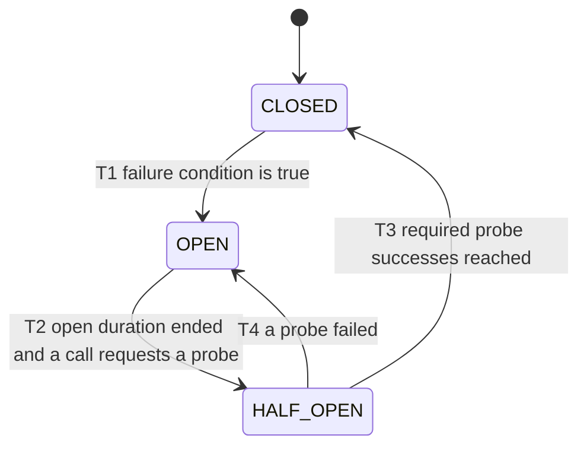

# State machine

This document is the specification of the breaker state machine.
The Go code and each store adapter must agree with it.

## 1. States

| State | Number | Behavior |
|---|---|---|
| `CLOSED` | `0` | The breaker permits all calls and records the results. |
| `OPEN` | `1` | The breaker rejects all calls. |
| `HALF_OPEN` | `2` | The breaker permits only calls that hold a probe lease. |

A breaker with no state in the store is `CLOSED` with generation 0.

## 2. Transitions



| ID | From | To | Trigger | Effects |
|---|---|---|---|---|
| T1 | `CLOSED` | `OPEN` | The shared window satisfies the failure condition. | Generation + 1. Record the transition time and the open duration. Delete the window. |
| T2 | `OPEN` | `HALF_OPEN` | A call requests a probe, and the store time is at or after the transition time plus the open duration. | Generation + 1. Record the transition time. Delete all probe leases. Set probe successes to 0. |
| T3 | `HALF_OPEN` | `CLOSED` | The number of probe successes reaches the required number. | Generation + 1. Record the transition time. Delete the window and the probe leases. |
| T4 | `HALF_OPEN` | `OPEN` | A probe with a valid lease reports a failure. | Generation + 1. Record the transition time and the open duration. Delete the probe leases. |

All other transitions are invalid.
These rules follow:

- `OPEN` never changes directly to `CLOSED`. A successful call that an instance started earlier cannot close the circuit.
- `CLOSED` never changes directly to `HALF_OPEN`.
- Transition T2 has no timer. The first call after the open duration causes it. A breaker with no traffic stays `OPEN` and costs nothing.

## 3. Generation rules

The generation is an integer. It starts at 0.

| Rule | Statement |
|---|---|
| G1 | Each transition increases the generation by exactly 1. |
| G2 | The generation changes only together with a transition, in one atomic operation. |
| G3 | Each permit carries the generation of the snapshot at the time of the permit decision. |
| G4 | A result is valid only for the generation of its permit. The store ignores results that carry another generation. |
| G5 | A write that carries an old generation never changes the state. |

Rule G4 prevents these errors:

- A slow call that started before the circuit opened ends with success after the circuit opened. Its result carries the old generation. The store ignores it.
- Failures from before a successful recovery arrive late. They carry an old generation. They cannot open the new `CLOSED` period.

## 4. Events

The state machine is a pure function:

```text
next(state, event, config, now) → (state, effects)
```

| Event | Source | Valid in |
|---|---|---|
| `Report(generation, calls, failures, slowCalls)` | Synchronizer | `CLOSED` with the same generation |
| `ProbeRequest(token)` | Request path | `OPEN` after the open duration, `HALF_OPEN` |
| `ProbeResult(generation, token, outcome)` | Request path | `HALF_OPEN` with the same generation and a valid lease |
| `Restore(snapshot)` | Reconciliation | Only when the snapshot generation is higher than the stored generation |

An event that is not valid in the current state causes no change.
The response always contains the current authoritative state.
The instance then replaces its snapshot.

## 5. Results of concurrent events

Each store adapter applies an operation atomically.
The operations on one breaker run in sequence.
For this reason, concurrent events have a total order.

| Situation | Result |
|---|---|
| Two instances send reports that each reach the threshold. | The first report makes T1. The second report carries the old generation. The store ignores it. The circuit opens one time. |
| 20 instances request a probe at the end of the open duration. | The first request makes T2 and gets a lease. The other requests find no free lease and get a rejection. |
| A probe reports success, and at the same time its lease ends and a second instance gets the lease. | Each result is valid only with its own token. A result for a lease that ended is ignored. |
| An instance reports `Report` counts while the state is `HALF_OPEN`. | The store ignores the counts. Only probe results count in `HALF_OPEN`. |

## 6. Local mode

In local mode, each instance runs the same state machine on local state.
The differences are:

- The window is the local window of the instance.
- The probe limit applies to the instance, not to all instances.
- Local transitions do not change the authoritative generation. The instance keeps the last authoritative generation that it read.

[Degraded mode](degraded-mode.md) describes how a local state returns to the authoritative state.

## 7. Invariants for tests

Property-based tests check these invariants with random event sequences:

1. The generation never decreases.
2. The state changes only through T1, T2, T3, or T4.
3. Each state change increases the generation by 1.
4. An event with an old generation never changes the state.
5. The number of valid leases never exceeds the probe limit.
6. The same sequence of events always gives the same sequence of states.
