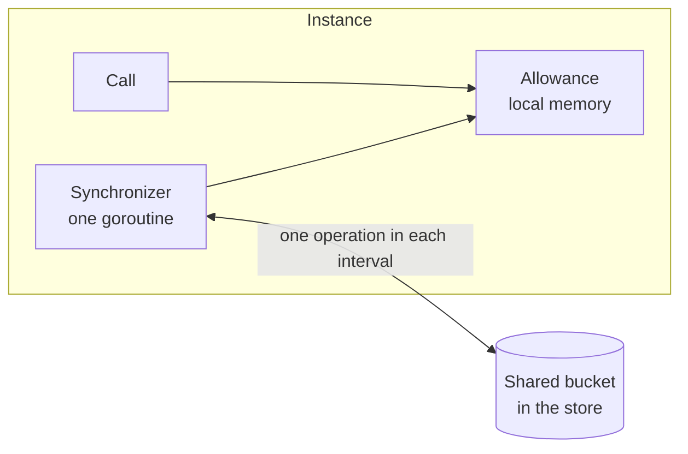

# Rate limiter

The rate limiter limits the number of calls that start in a time period.
Without a store, it works in one process and keeps its state in local memory.
With a store, the instances of a service share one limit. Section 5 describes this function.

The [requirements](requirements.md) list what the limiter must do. Each requirement has an identifier.

## 1. Purpose

Use the rate limiter in these conditions:

- A dependency accepts only a fixed number of calls each second.
- A service must limit the calls that it accepts each second.

The limiter uses the token bucket algorithm.
The bucket holds tokens. A call needs one token.
The bucket gets new tokens at a constant rate, up to a maximum that is the burst.
When the bucket holds no token, the limiter rejects the call. The limiter does not wait.

## 2. API

The package is `github.com/faultvane/faultvane-go/ratelimit`.

| Item | Function |
|---|---|
| `New(opts ...Option) (*Limiter, error)` | Makes a limiter. It returns an error when the configuration is invalid. |
| `(*Limiter).Do(ctx, call) error` | Runs the call when a token is available. A `Limiter` is a `faultvane.Policy`. |
| `(*Limiter).Allow() bool` | Removes one token and returns `true`. It returns `false` when no token is available. |
| `(*Limiter).Stats() Stats` | Returns the statistics of the limiter. Section 6 describes them. |
| `(*Limiter).Close(ctx) error` | Stops the synchronizer of a limiter with a store. It does nothing for a limiter without a store. |
| `ErrRateLimited` | The error of a rejected call. It matches `faultvane.ErrRejected`. |
| `Store`, `Acquire`, `Grant` | The interface of a shared store and the data of its operation. [Store](store.md) describes them. |
| `NewMemoryStore(clock) *MemoryStore` | Makes a store in local memory. Use it for tests and for limiters in one process. |
| `Bucket` | The calculation of one store operation. A store adapter uses it. [Store](store.md) describes it. |
| `Observer`, `Event`, `EventKind` | The interface and the data of the events. Section 7 describes them. |

### Limit a function

```go
limiter, err := ratelimit.New(
    ratelimit.WithRate(50),
    ratelimit.WithBurst(10),
)
if err != nil {
    return err
}

err = limiter.Do(ctx, func(ctx context.Context) error {
    return client.Send(ctx, message)
})
if errors.Is(err, ratelimit.ErrRateLimited) {
    return errTryLater
}
```

### Make only the decision

Use `Allow` when the code does not put the work in a function, for example in an HTTP handler.

```go
if !limiter.Allow() {
    http.Error(w, "too many requests", http.StatusTooManyRequests)
    return
}
```

### Return a value

`faultvane.Execute` returns the value of a call.

```go
user, err := faultvane.Execute(ctx, limiter, func(ctx context.Context) (User, error) {
    return client.User(ctx, id)
})
```

## 3. Options

| Option | Default | Valid values | Function |
|---|---|---|---|
| `WithRate(perSecond float64)` | 100 | Above 0 and at most 1e9 | The number of tokens that the bucket gets each second. |
| `WithBurst(n int)` | The rate rounded up to a whole number | 1 or more | The largest number of tokens that the bucket can hold. |
| `WithClock(clock faultvane.Clock)` | `faultvane.SystemClock()` | Not nil | The source of time. Tests use `faultvanetest.Clock`. |

An invalid value makes `New` return an error that matches `faultvane.ErrInvalidConfig`.
The error message names the option and the rule, for example `faultvane: invalid configuration: Rate must be above 0 and at most 1e9`.

A rate below 1 is valid. For example, a rate of 0.2 gives one token each 5 seconds.

When you set only the rate, the burst follows the rate. A rate of 2.5 gives a burst of 3.

## 4. Behavior rules

1. A new limiter has a full bucket. The first calls, up to the burst, are permitted immediately.
2. A permitted call removes one token.
3. A rejected call removes no token.
4. The bucket gets tokens in proportion to the elapsed time. The limiter calculates the refill when a call arrives. A limiter without a store starts no goroutine and no timer.
5. The bucket never holds more tokens than the burst.
6. A part of a token stays in the bucket. With a rate of 10, one token is available 100 ms after the bucket is empty, and not before that time.
7. The refill has no drift. The limiter calculates the tokens from the time when the bucket was last full. It does not add small amounts for each call.
8. `Do` returns the error of the call without a change.
9. When the context has ended before the call starts, `Do` returns the error of the context. It runs nothing and removes no token.
10. A panic of the call continues to the caller with the same value.
11. All methods are safe for concurrent use.

### Rate and burst

The rate limits the calls over a long time. The burst limits the calls at one instant.
In a period of `t` seconds, the limiter permits at most `burst + rate × t` calls.

| Aim | Configuration |
|---|---|
| Permit short peaks | A burst above the rate |
| Give calls an equal distance in time | A burst of 1 |

## 5. Shared limit

A limiter with a store shares one bucket with all limiters that use the same store and the same name.
The bucket is in the store. This document calls it the shared bucket.

```go
client := redis.NewClient(&redis.Options{Addr: "redis.internal:6379"})

store, err := redisstore.NewRateLimitStore(client, redisstore.WithNamespace("production"))
if err != nil {
    return err
}

limiter, err := ratelimit.New(
    ratelimit.WithRate(500),
    ratelimit.WithBurst(50),
    ratelimit.WithStore(store),
    ratelimit.WithName("payment-api"),
    ratelimit.WithLocalRate(50),
)
if err != nil {
    return err
}
defer limiter.Close(ctx)
```

All limiters with one name must have the same rate and the same burst.

These stores exist:

| Store | Constructor |
|---|---|
| In-memory | `ratelimit.NewMemoryStore(clock)` |
| Redis | `redisstore.NewRateLimitStore(client, opts...)` |
| SQL (PostgreSQL and MySQL) | `sqlstore.NewRateLimitStore(db, dialect, opts...)` |
| MongoDB | `mongostore.NewRateLimitStore(collection, opts...)` |

[Store](store.md) describes the setup, the data, and the limits of each store.

### Options

| Option | Default | Valid values | Function |
|---|---|---|---|
| `WithStore(store Store)` | No store | Not nil | The store of the shared bucket. |
| `WithName(name string)` | None. A limiter with a store must have a name. | 1 to 64 characters from `a-z`, `A-Z`, `0-9`, `.`, `_`, `-` | The name of the shared bucket. |
| `WithSyncInterval(d time.Duration)` | 100 ms | Longer than the store timeout | The time between two synchronizations. |
| `WithStoreTimeout(d time.Duration)` | 50 ms | Above 0 | The time limit of one store operation. |
| `WithLocalRate(perSecond float64)` | The rate | Above 0 and at most the rate | The rate of this instance in local mode. |
| `WithFaultThreshold(n int)` | 3 | 1 or more | The number of failed synchronizations in sequence before local mode. |

A limiter without a store ignores these options.

Set `WithLocalRate` to the rate divided by the number of instances.
The default is the full rate for each instance. With the default and 10 instances, the dependency can receive 10 times the rate while the store is not available.

### How it works



1. A call takes one token from the allowance. The allowance is in local memory. A call never calls the store.
2. When the allowance is empty, the limiter rejects the call.
3. The synchronizer makes one store operation in each synchronization interval. The number of calls does not change the load on the store.
4. In each synchronization, the limiter calculates a batch. The batch is two times the number of calls of the last interval. Permitted calls and rejected calls count. The batch is at least 1 and at most the burst.
5. The limiter asks the store for the tokens that it needs to hold the batch. It gives back the tokens that it holds above the batch. Thus an instance without calls holds one token.
6. `New` makes the first synchronization. The first batch is the rate multiplied by the synchronization interval, rounded up, and at most the burst.
7. The store refills the shared bucket with its own clock. The clocks of the instances have no effect on the shared rate.

### Guarantee

`N` is the number of instances. All instances are in distributed mode.

- In each time window of `t` seconds, all instances together permit at most `burst + rate × t + H` calls.
- `H` is the number of tokens that the instances hold at the start of the window. A token that the store granted in an operation that has not ended is also in `H`.
- One instance never holds more than its batch, and a batch is never above the burst. Thus `H` is at most `N × burst`.
- For a window that starts before the first instance starts, `H` is 0. The limit is then `burst + rate × t`, the same as for one limiter without a store.

The reason is as follows. Each token is in the shared bucket or in the allowance of one instance. The shared bucket holds at most `burst` tokens and gets at most `rate × t` new tokens in `t` seconds. A permitted call removes one token. No other operation makes a token.

In usual operation `H` is much smaller than `N × burst`.
An instance without calls holds 1 token. An instance with a constant number of calls holds at most two times the calls of one synchronization interval.

The property test `TestGuarantee` in `ratelimit/shared_test.go` checks this limit for each window of random sequences of calls and synchronizations.
The acceptance tests RL-39, RL-52, and RL-57 check it with 10 limiters and a real Redis, PostgreSQL, MySQL, and MongoDB.
The [scenarios in Docker](../scenarios.md) check it with 10 pods in separate containers, also after a Redis outage.

### Local mode

When the store is not available, the limiter continues with local state.

1. A failed synchronization does not change the mode immediately. The limiter continues to use its allowance.
2. After `FaultThreshold` failed synchronizations in sequence, the limiter changes to local mode.
3. In local mode, the limiter uses a local bucket. The rate is `LocalRate`. The local burst is `burst × LocalRate / rate`, rounded up. The limiter keeps the tokens that it holds, up to the local burst.
4. In local mode, the limiter makes one store operation in each synchronization interval. It makes no other attempts.
5. The first operation that succeeds returns the limiter to distributed mode. The allowance is then the grant of the store. The limiter does not give tokens of the local bucket to the store.
6. When the store is not available during `New`, the limiter starts in local mode with a full local bucket.
7. After `Close`, the limiter is in local mode.

A fault of the store never fails a call and never blocks a call.
In local mode, one instance permits at most `local burst + LocalRate × t` calls in `t` seconds.

The tokens of a failed synchronization are lost. The instances then permit fewer calls than the limit, never more.

## 6. Statistics and metrics

`Stats` returns a copy of the counters of the limiter.

| Field | Content |
|---|---|
| `Mode` | `Distributed` or `Local`. A limiter without a store is always in local mode. |
| `Permitted` | The number of permitted calls. |
| `Rejected` | The number of rejected calls. A call that its context stopped is not counted. |
| `StoreErrors` | The number of failed synchronizations. |
| `Allowance` | The number of whole tokens that the limiter holds now. The largest value that it shows is 2^62. |

The module `otel` gives these statistics as OpenTelemetry metrics.

```go
registration, err := faultvaneotel.RegisterRateLimitMetrics(meter, "payment-api", limiter)
if err != nil {
    return err
}
defer registration.Unregister()
```

| Metric | Type | Attributes |
|---|---|---|
| `faultvane.rate_limiter.calls` | Counter | `faultvane.rate_limiter.decision`: `permitted` or `rejected` |
| `faultvane.rate_limiter.store_errors` | Counter | None |
| `faultvane.rate_limiter.mode` | Gauge. 1 for the current mode, 0 for the other mode. | `faultvane.rate_limiter.mode`: `distributed` or `local` |
| `faultvane.rate_limiter.allowance` | Gauge | None |

Each metric also has the attribute `faultvane.policy.name`. Its value is the name that the application gives to `RegisterRateLimitMetrics`.
Use a fixed name for each limiter. Do not use a value from a request.

Section 7 describes the events and the logs for a mode change and for a store fault.

## 7. Events and logs

A limiter with a store has two modes, and its store can fail.
The limiter reports each mode change and each store fault with an event and with a log record.
The limiter reports nothing for a call. A call changes only the counters of `Stats`.
A limiter without a store has no mode change and no store fault. It gives no event and writes no log.

### Options

| Option | Default | Valid values | Function |
|---|---|---|---|
| `WithObserver(observer Observer)` | No observer | Not nil | The receiver of the events. |
| `WithLogger(logger *slog.Logger)` | `slog.Default()` | Not nil | The logger of the package `log/slog` that gets the log records. |

A limiter without a store ignores these options.

```go
limiter, err := ratelimit.New(
    ratelimit.WithStore(store),
    ratelimit.WithName("payment-api"),
    ratelimit.WithObserver(observer),
    ratelimit.WithLogger(logger),
)
```

### Events

```go
type Observer interface {
    Observe(Event)
}
```

| Field of `Event` | Content |
|---|---|
| `Kind` | `ModeChanged` or `StoreFault` |
| `Limiter` | The name of the limiter |
| `Mode` | The mode after the event: `Distributed` or `Local` |
| `Err` | The error of the store. A change that has no store fault as its cause has `nil`. |

| Kind of event | Text of `Kind.String()` | When |
|---|---|---|
| `StoreFault` | `store_fault` | A synchronization fails while the limiter is in distributed mode, or the synchronization of `New` fails. |
| `ModeChanged` | `mode_changed` | The limiter changes to local mode or to distributed mode. |

Rules:

- A failed synchronization in distributed mode gives one `StoreFault` event. The synchronization that reaches `FaultThreshold` gives a `StoreFault` event and then a `ModeChanged` event. The two events have the mode `Local` and the same error.
- A failed synchronization in local mode gives no event. It only increases `StoreErrors`.
- The first synchronization that succeeds in local mode gives one `ModeChanged` event with the mode `Distributed`.
- When the synchronization of `New` fails, the limiter gives a `StoreFault` event and a `ModeChanged` event with the mode `Local`. When it succeeds, the limiter gives no event.
- `Close` gives one `ModeChanged` event with the mode `Local` and no error. `Close` of a limiter in local mode gives no event.
- The limiter calls the observer after it released its lock. The goroutine is the synchronizer, or the caller of `New` or `Close`. A call never waits for the observer.
- The limiter waits for the observer before the next synchronization. The observer must return quickly.
- The observer must not call `Close` of the same limiter. `Close` waits for the synchronizer, and the synchronizer waits for the observer.
- When the observer panics, the limiter recovers and writes an error log. The synchronizer continues.
- The limiter writes the log of an event before it calls the observer.

### Logs

| Event | Message | Level |
|---|---|---|
| Change to local mode after a store fault | `rate limiter mode changed` | `WARN` |
| Change to local mode by `Close` | `rate limiter mode changed` | `INFO` |
| Change to distributed mode | `rate limiter mode changed` | `INFO` |
| Failed synchronization that gives a `StoreFault` event | `rate limiter synchronization failed` | `DEBUG` |
| The observer panicked | `rate limiter observer panic` | `ERROR` |

| Attribute | Content |
|---|---|
| `limiter` | The name of the limiter |
| `mode` | The mode after the event: `distributed` or `local` |
| `cause` | The text of the store error. Only a record for an event with an error has it. |
| `panic` | The value of the panic. Only the record for an observer panic has it. This record has no `mode` and no `cause`. |

The `cause` attribute contains the text of the error from the store adapter. It can contain the address of the store. A store adapter must not put credentials in the text of its errors.
A store operation gets no data of an application call. Thus a record contains no credentials, no request payloads, and no tokens of a request.

### Number of records in a store outage

Decision: a store fault gives a record only until the limiter is in local mode.

| Period | Records |
|---|---|
| Start of the outage | One `DEBUG` record for each failed synchronization, `FaultThreshold` records in total. Then one `WARN` record for the mode change. |
| Remaining time of the outage | None. |
| End of the outage | One `INFO` record for the mode change. |

The reasons are as follows:

- The limiter synchronizes 10 times each second with the default interval. One record for each failed synchronization gives 36 000 records for each instance in an outage of one hour. These records contain no new data after the first records.
- The `WARN` record of the mode change contains the cause. An operator who reads only `WARN` records gets the fault and its effect in one record.
- `StoreErrors` and the metric `faultvane.rate_limiter.store_errors` count each failed synchronization. Use them to see that the outage continues.
- The circuit breaker uses the same rule for its health checks in local mode.

The test `TestLogs` in `ratelimit/observe_test.go` makes 1000 failed synchronizations in sequence. It gets 3 `DEBUG` records and 1 `WARN` record.

## 8. Interaction with the other policies

[Policy composition](../policy-composition.md) gives the recommended order of the policies.
The rate limiter is the second policy from the outside. Load shedding is before it.

```go
pipeline := faultvane.Combine(shedder, limiter, breaker)
```

| Policy | Interaction |
|---|---|
| Load shedding | It is outside the rate limiter. Work that load shedding rejects uses no token. |
| Circuit breaker | It is inside the rate limiter. A rejection of the limiter does not reach the breaker, so the breaker does not count it as a failure. |
| Retry | A retry policy must not try again after `faultvane.ErrRejected`. With the limiter outside the retry policy, one request uses one token. With the limiter inside the retry policy, each attempt uses one token. |

A token that a call removed does not come back. This is also true when a policy inside the limiter rejects the call.

## 9. Limits

- Without a store, the limit applies to one process. Each instance of a service has its own bucket. With 10 instances and a rate of 100, the dependency can receive 1000 calls each second.
- With a store, the instances can permit more calls than `burst + rate × t` for a short time. Section 5 gives the largest number. The cause is the tokens that the instances hold in local memory.
- With a store, an instance rejects a call when its allowance is empty, also when the shared bucket holds tokens. This occurs when the number of calls of one instance increases quickly. The next synchronization corrects the batch.
- With a store, one instance permits at most its allowance at one instant, not the full burst.
- With a store and more calls than the rate, the instances do not get equal parts of the rate. The instance that synchronizes first gets the tokens.
- An instance does not give its tokens back when it stops. `Close` does not call the store. The tokens of a failed synchronization are also lost. The instances then permit fewer calls than the limit.
- Each instance holds at least 1 token after it got one. When the number of instances is near the burst or above it, the tokens of idle instances are a large part of the burst.
- In local mode, the instances do not coordinate. The total rate is the sum of the local rates.
- Only four stores exist: the in-memory store, the Redis store, the SQL store for PostgreSQL and MySQL, and the MongoDB store. [Store](store.md) gives the limits of each store. The Redis store has tests with one Redis server without cluster mode, with one Redis server with cluster mode on, and with a cluster of 3 nodes.
- The limiter writes no log for a failed synchronization in local mode. `StoreErrors` counts these faults.
- The observer gets no event for a call. The numbers of permitted and rejected calls come from `Stats`.
- The limiter does not wait for a token. The application decides what to do after a rejection.
- A call needs exactly one token. A weight for each call is not available.
- One limiter has one bucket. For a limit for each client, the application keeps one limiter for each client and sets a limit on the number of limiters.
- The limiter calculates with 64-bit floating-point numbers. An error of calculation is possible only when the bucket does not become full for more than approximately 10^15 tokens. That error is far below one token in normal use.
- The limiter protects its bucket with a mutex. The benchmarks in `ratelimit/bench_test.go` measure the cost. A lock-free design was slower with 10 parallel goroutines on the test machine. A limiter with a store uses the same mutex and the same path for a call.
