# Roadmap

This document is the delivery plan of Faultvane for Go.
Each milestone has a scope and exit criteria.
A milestone is complete only when all its exit criteria are true.

The identifiers refer to the [requirements](requirements.md).

## 1. Overview

```mermaid
flowchart LR
    M0[M0 Foundation] --> M1[M1 Local breaker]
    M1 --> M2[M2 Shared state]
    M2 --> M3[M3 Probe coordination]
    M3 --> M4[M4 Degraded mode]
    M4 --> M5[M5 Observability]
    M5 --> M6[M6 Hardening]
    M6 --> M7[M7 Release 0.1.0]
    M7 --> M8[M8 Timeout and retry]
    M8 --> M9[M9 Bulkhead and concurrency limiter]
    M9 --> M10[M10 Rate limiter and load shedding]
```

| Milestone | Result | Status |
|---|---|---|
| M0 | Repository, requirements, design, plan | In progress |
| M1 | A correct local circuit breaker with the public API | Planned |
| M2 | Shared state and shared failure detection through Redis | Planned |
| M3 | Probes coordinated across instances | Planned |
| M4 | Local mode, reconciliation, and data loss handling | Planned |
| M5 | Metrics, logs, and traces | Planned |
| M6 | Chaos tests and benchmarks | Planned |
| M7 | First release of the distributed circuit breaker | Planned |
| M8 to M10 | The other resilience policies | Planned |

Each milestone delivers working and tested code.
The breaker is usable as a local breaker after M1 and as a distributed breaker after M4.

## 2. Milestones for the circuit breaker

### M0: Foundation

Scope:

- Repository structure, README, contribution rules, security policy, changelog.
- Requirements with identifiers.
- Architecture, design documents, and decision records.
- This roadmap.

Exit criteria:

- [x] The documents exist and agree with each other.
- [ ] The owner approved the open decisions in section 5.
- [ ] The repository has a license.
- [ ] Continuous integration runs build, `go vet`, static analysis, and tests on each change.

### M1: Local breaker

Scope:

- Core package: errors, clock interface, fake clock for tests.
- State machine as pure functions.
- Local window with atomic counters.
- `New`, `Execute`, `Do`, `Allow`, and the permit.
- Classifier and slow call detection.
- Configuration options and validation.

Requirements: SM-1 to SM-8, FD-1 to FD-5, API-1 to API-5, ERR-1, ERR-2, CFG-1 to CFG-3, PF-4 to PF-6.

Exit criteria:

- The unit tests of [testing.md](testing.md) section 3 and the property tests of the state machine invariants pass with `-race`.
- The request path benchmark exists. `Execute` in `CLOSED` makes 0 allocations.
- The core module has no dependencies.

### M2: Shared state

Scope:

- Store interface.
- Redis store module with the key schema.
- Scripts `report` and `restore`, and the snapshot refresh.
- Synchronizer: reports, early reports, snapshot replacement, clock difference.
- Generation rules.
- TTL rules.

Requirements: DS-1 to DS-4, GEN-1 to GEN-3, FD-6, FD-7, KEY-1, KEY-2, TTL-1, TTL-2, RF-2, PF-1, PF-3.

Exit criteria:

- Script tests pass for each branch of `report` and `restore`.
- Acceptance test **AT-1** passes: 10 instances open the circuit together.
- Acceptance test **AT-5** passes: Redis ignores a write with an old generation.
- A test shows that the number of Redis operations does not change with the request rate.
- The tests run against Redis standalone and Redis Cluster.

### M3: Probe coordination

Scope:

- Scripts `acquire_probe` and `complete_probe`.
- Probe path on the request path with the attempt flag and the attempt interval.
- Lease expiry.
- `HalfOpenMaxProbes` and `HalfOpenSuccessThreshold`.

Requirements: HO-1 to HO-5, SM-4 to SM-6 in distributed mode.

Exit criteria:

- Acceptance test **AT-2** passes: exactly one probe with 10 instances.
- A test shows that a lease of a stopped instance ends and another instance gets it.
- A test shows that a result with an old token has no effect.

### M4: Degraded mode and reconciliation

Scope:

- Detection of store faults and health checks with backoff.
- Local mode from each state.
- Local thresholds, the time limit, and the expired policies.
- Start policies.
- Reconciliation.
- Data loss detection and `restore`.

Requirements: DG-1 to DG-7, RC-1 to RC-6, RF-1, RF-3 to RF-5, ERR-3.

Exit criteria:

- Acceptance test **AT-3** passes: requests continue without Redis.
- Acceptance test **AT-4** passes: reconciliation without a stale write and without flapping.
- Acceptance test **AT-6** passes: no split-brain condition after recovery.
- A test covers each row of the reconciliation table and of the fault matrix in [degraded mode](circuit-breaker/degraded-mode.md).
- A test shows that no request waits longer than the store timeout during a Redis fault.

### M5: Observability

Scope:

- Observer interface and events.
- Logs with `log/slog`.
- OpenTelemetry module with metrics and trace attributes.

Requirements: OB-1 to OB-5, SEC-2.

Exit criteria:

- A test asserts each metric and each log event of [observability.md](observability.md).
- A benchmark shows that the request path cost does not change when no observer is installed.
- A test shows that logs contain no data of a request.

### M6: Hardening

Scope:

- Chaos tests.
- System benchmarks with 1, 10, 50, and 100 instances.
- Goroutine leak tests and a long run for memory.
- Corrections of the defects that these tests find.

Requirements: PF-1 to PF-6, RF-1.

Exit criteria:

- All chaos tests of [testing.md](testing.md) section 7 pass.
- Acceptance test **AT-7** passes. The benchmark results are in the repository.
- A run of one hour shows constant memory and a constant number of goroutines.

### M7: Release 0.1.0

Scope:

- Example applications: an HTTP client and a gRPC client.
- Documentation update from design to behavior, with measured values.
- Package documentation and runnable examples.
- Changelog and version tags for each module.

Requirements: SEC-1, PI-1 as documentation.

Exit criteria:

- All acceptance tests AT-1 to AT-7 pass in continuous integration.
- The definition of done in section 4 is true.
- The examples run with one command.

## 3. Milestones for the other policies

Each policy gets its own requirements and design document before its implementation starts.

### M8: Timeout and retry

- Timeout for each attempt, with `timeout.ErrTimeout`.
- Retry with backoff, jitter, and a retry budget.
- Composition of policies in the recommended order.
- The retry rules of [policy composition](policy-composition.md): rejections are final, state check before each attempt, probes do not retry.

Requirements: PI-1 to PI-3.

### M9: Bulkhead and concurrency limiter

- Bulkhead with a fixed limit of concurrent calls and an optional wait queue with a limit.
- Concurrency limiter that adapts the limit to the measured latency.

### M10: Rate limiter and load shedding

- Local rate limiter.
- Load shedding by priority.
- Evaluation of a distributed rate limiter on the same store.

## 4. Definition of done for the distributed circuit breaker

- [ ] Instances share the breaker state correctly.
- [ ] A normal call needs no Redis round trip.
- [ ] A Redis fault does not break the breaker.
- [ ] Local mode works correctly.
- [ ] Recovery reconciles the state safely.
- [ ] A stale instance cannot overwrite a newer state.
- [ ] The probe limit applies to all instances together.
- [ ] Concurrent transitions are safe.
- [ ] An instance that starts continues from the authoritative state.
- [ ] Redis restart and failover are handled.
- [ ] A dependency failure does not cause a retry storm. This item needs M8.
- [ ] Metrics and logs give sufficient information for operation.
- [ ] Benchmarks show that the cost is acceptable.
- [ ] Each critical race has an automated test.
- [ ] The documentation describes the consistency model and the failure model.

## 5. Open decisions

The owner of the project must confirm these decisions before M1 starts.

| Topic | Proposal | Effect of a change |
|---|---|---|
| Module path | `github.com/faultvane/faultvane-go` | Cheap before the first release. Expensive after it. |
| License | Not selected | Necessary before publication. |
| Minimum Go version | 1.24 | Sets the language features that the code can use. |
| Redis client | `github.com/redis/go-redis/v9` | Sets the dependency of the store module. |
| Default start policy | `StartWithProbe` | See [ADR 0004](adr/0004-local-breaker-fallback.md). |
| Default policy after the local mode time limit | `KeepLocalBreaker` | See [ADR 0004](adr/0004-local-breaker-fallback.md). |
| Window type | Time-based only | See [failure detection](circuit-breaker/failure-detection.md). |

## 6. Risks

| Risk | Effect | Mitigation |
|---|---|---|
| The shared window is less exact than a record of each call. | The circuit opens a short time late. | Early reports. The limits are documented and tested. |
| Different configurations between instances. | The failure condition depends on the reporter. | Fingerprint, warning, and metric. |
| Lua scripts are difficult to debug. | Defects in the transitions. | Small scripts. A test for each branch. The state machine specification is the reference. |
| Tests with real time are not stable. | Slow or flaky continuous integration. | Fake clock in unit tests. Wait for conditions in integration tests. |
| The scope of seven policies is large. | The first release is late. | The circuit breaker is complete and released before the other policies start. |
