# Roadmap

This document is the delivery record of the Faultvane toolkit for Go.
The toolkit contains seven policies. The circuit breaker was the first, because it has the most complex design and it defines the model for shared state.
Each milestone has a scope and exit criteria.

Status on 2026-11-24: the code of all milestones M1 to M12 is implemented and merged.
No release tag exists. The release is the decision of the owner of the project.
Some exit criteria are not satisfied. Each milestone below gives its real result, and section 5 lists the open items.

The identifiers refer to the [toolkit requirements](requirements.md) and the [circuit breaker requirements](circuit-breaker/requirements.md).

## 1. Overview

```mermaid
flowchart LR
    M0[M0 Foundation] --> M1[M1 Local breaker]
    M1 --> M2[M2 Shared state]
    M2 --> M3[M3 Probe coordination]
    M3 --> M4[M4 Degraded mode]
    M4 --> M5[M5 Observability]
    M5 --> M6[M6 Hardening]
    M6 --> M7[M7 Release 0.1.0]
    M7 --> M8[M8 SQL adapter]
    M8 --> M9[M9 MongoDB adapter]
    M9 --> M10[M10 Timeout and retry]
    M10 --> M11[M11 Bulkhead and concurrency limiter]
    M11 --> M12[M12 Rate limiter and load shedding]
```

The diagram shows the planned order. The real order was different: the work on M8 to M12 did not wait for the release of M7.

| Milestone | Result | Status |
|---|---|---|
| M0 | Repository, requirements, design, plan | Done |
| M1 | The core of the toolkit and a correct local circuit breaker | Done |
| M2 | Shared state and shared failure detection through a store, with the in-memory adapter and the Redis adapter | Done |
| M3 | Probes coordinated across instances | Done |
| M4 | Local mode, reconciliation, and data loss handling | Done |
| M5 | Logs, events, counters, and the OpenTelemetry module | Done |
| M6 | Fault tests and the system benchmark | Done, with open items |
| M7 | First release of the distributed circuit breaker | Code and documents done. Not released. |
| M8 | SQL adapter for PostgreSQL and MySQL | Done, with open items |
| M9 | MongoDB adapter | Done, with open items |
| M10 | Timeout and retry | Done |
| M11 | Bulkhead and concurrency limiter | Done |
| M12 | Rate limiter and load shedding | Done. The rate limiter can share its limit through a store. |

### Exit criteria for each milestone

These criteria apply to each milestone from M1.

| Criterion | Result |
|---|---|
| All quality gates of [testing.md](testing.md) section 1 pass. | The active gates pass in continuous integration. The benchmark comparison is not active. |
| The statement coverage is 98% or more for each module and 95% or more for each package (QA-1, QA-2). | Continuous integration enforces it for the core module, the three adapter modules, and the `otel` module. |
| Each requirement that the milestone names has a test with its identifier (QA-5). | 278 of the 294 requirements are in `scripts/implemented-requirements.txt`, and each has a test. The other 16 are requirements about the process, the documentation, or performance targets: QA-1 to QA-7, QA-10 to QA-12, QA-14, SEC-2, TK-4, and TK-51 to TK-53. No test names them. |
| Each scenario that the design documents of the milestone describe has a test. | Not verified for each scenario. The tests of each milestone exist. |
| The mutation score of the critical packages that the milestone changes is 90% or more (QA-9). | The mutation gate measures it each day for the seven policy packages. [Testing](testing.md) section 2 records the result. |

## 2. Milestones for the circuit breaker

### M0: Foundation

Scope:

- Repository structure, README, contribution rules, security policy, changelog.
- Requirements with identifiers.
- Architecture, design documents, and decision records.
- This roadmap.

Exit criteria:

- [x] The documents exist and agree with each other.
- [x] The owner approved the decisions in section 7.
- [x] The repository has a license.
- [x] Continuous integration runs build, `go vet`, static analysis, and tests on each change.
- [x] Continuous integration enforces the coverage minimum of QA-1 and QA-2.

### M1: Local breaker

Scope:

- Core package: errors, clock interface, fake clock for tests, policy interface, `Combine`, and `Execute`.
- State machine as pure functions.
- Local window with atomic counters.
- `New`, `Execute`, `Do`, `Allow`, and the permit.
- Classifier and slow call detection.
- Configuration options and validation.
- Test infrastructure: property tests, fuzz targets, the goroutine check, and the traceability check.

Result on 2026-11-24:

- [x] All active quality gates pass. The statement coverage was 100% for each package at the end of this milestone.
- [x] 40 requirements were in `scripts/implemented-requirements.txt` at the end of this milestone, and each had a test.
- [x] The benchmarks exist. [Benchmarks](benchmarks.md) records the baseline: 83 ns for a call on a closed breaker, with 0 allocations.
- [x] The core module has no dependencies. The test `TestDependencies` checks it.
- [x] The property test and the fuzz target check the six invariants of the state machine.
- [x] A manual mutation run changed 43 conditions and values in the code. The tests failed for 42. The last change has no effect on the behavior.
- [x] The automated mutation gate is active. See [testing](testing.md) section 2.

Differences from the plan:

- `ErrStoreUnavailable`, `Mode`, and `Close` came with the store in M2.
- The failure rate condition is always on. The design permitted to turn it off.

### M2: Shared state

Scope:

- Store interface with the operations `Load`, `Report`, and `Restore`.
- In-memory adapter.
- Conformance suite for these operations, as a gate in continuous integration with a real store (QA-7, QA-8).
- Synchronizer: reports, early reports, snapshot replacement, clock difference.
- Generation rules.
- Redis adapter module: key schema, scripts, TTL rules.

Requirements: DS-1 to DS-8, GEN-1 to GEN-3, FD-6, FD-7, KEY-1, KEY-2, TTL-1, TTL-2, RF-2, PF-1, PF-3.

Result:

- [x] The in-memory adapter and the Redis adapter pass the conformance suite.
- [x] Acceptance test **AT-1** passes with each adapter: 10 instances open the circuit together.
- [x] Acceptance test **AT-5** passes with the in-memory adapter. For each other adapter, the conformance suite has the check "a report with a different generation adds nothing".
- [x] The system benchmark shows that the number of store operations does not increase with the request rate.
- [x] The Redis tests run against a standalone Redis and against one Redis server with cluster mode on.
- [ ] Not done: a test against a Redis Cluster with many nodes.
- [x] The core module still has no dependencies.

Differences from the plan:

- The in-memory adapter is in the package `circuitbreaker`, not in `store/memory`. The conformance suite is in `circuitbreaker/storetest`, not in `store/storetest`.
- The state machine is the exported type `Record`. See [ADR 0007](adr/0007-shared-record-for-go-adapters.md).
- The breaker does not reject a low state TTL. It uses an effective value. See [configuration](circuit-breaker/configuration.md).
- The configuration fingerprint is not implemented.

### M3: Probe coordination

Scope:

- Store operations `AcquireProbe` and `CompleteProbe` in the interface, the conformance suite, and the adapters.
- Probe path on the request path with the attempt flag and the attempt interval.
- Lease expiry.
- The maximum number of probes and the half-open success threshold.

Requirements: HO-1 to HO-5, SM-4 to SM-6 in distributed mode.

Result:

- [x] Acceptance test **AT-2** passes with each adapter: exactly one probe with 10 instances.
- [x] The conformance suite shows that a lease ends without an action of its owner and that a later request gets a lease.
- [x] The conformance suite shows that a result with an unknown token or a different generation has no effect.

### M4: Degraded mode and reconciliation

Scope:

- Detection of store faults and health checks with an interval that increases.
- Local mode from each state.
- Local thresholds, the time limit, and the expired policies.
- Start policies.
- Reconciliation.
- Data loss detection and `Restore`.

Requirements: DG-1 to DG-7, RC-1 to RC-6, RF-1, RF-3 to RF-5, ERR-3.

Result:

- [x] Acceptance test **AT-3** passes with the in-memory adapter and with Redis: requests continue without the store.
- [x] Acceptance test **AT-4** passes with the in-memory adapter and with Redis: reconciliation without a stale write.
- [x] Acceptance test **AT-6** passes with the in-memory adapter and with Redis: no split-brain condition after recovery.
- [x] The tests `TestLocalMode`, `TestLocalModeLimit`, `TestStartWithoutStore`, `TestReconciliation`, and `TestDataLoss` cover local mode, reconciliation, and data loss. This document does not verify that a test exists for each row of the tables in [degraded mode](circuit-breaker/degraded-mode.md).
- [x] A test of the Redis adapter shows that a slow store delays no call.
- [x] No code of this milestone is in an adapter. The core owns it.
- [x] AT-3, AT-4, and AT-6 pass with the SQL adapter and the MongoDB adapter.

Differences from the plan:

- No separate random wait exists before reconciliation. The random wait before each health check has this function.
- A probe that holds a lease from the store when its instance changes to local mode loses its result.

### M5: Observability

Scope:

- Observer interface and events.
- Counters with `Stats`.
- Logs with `log/slog`.
- OpenTelemetry module with metrics, the duration of store operations, and trace attributes.

Requirements: OB-1 to OB-5, SEC-2.

Result:

- [x] Tests assert the metrics, the log events, and the trace attributes: `TestObservability` in the core module, and `TestMetrics`, `TestTraced`, and `TestInstrumentStore` in the `otel` module.
- [x] The request path benchmark after this milestone is 84 ns for a call on a closed breaker. The baseline was 83 ns. See [benchmarks](benchmarks.md).
- [ ] Not done: a test with the identifier SEC-2. The breaker logs only its name, states, generation, mode, and the text of a store error.

Differences from the plan:

- The metrics do not come from the observer. The `otel` module reads `Stats`.
- The metrics `stale_writes` and `config_mismatch` do not exist.
- The traces have no attribute for the generation and no child span for a probe.
- A failed health check in local mode gives no log and no event. It only increases a counter.
- The circuit breaker has full observability. Five other policies have statistics and metrics. See section 5.

### M6: Hardening

Scope:

- Chaos tests.
- System benchmarks with 1, 10, 50, and 100 instances.
- Goroutine checks.

Requirements: PF-1 to PF-6, RF-1.

Result:

- [x] The fault tests exist as normal tests: a fake store in the core module, and a TCP proxy in the tests of the Redis adapter. They run with each change.
- [ ] Not done: chaos tests as a separate scheduled gate. No test stops or restarts a store container.
- [x] Acceptance test **AT-7** passes with the Redis adapter. [Benchmarks](benchmarks.md) records the results. A workflow runs the test each week.
- [x] A run of one hour shows no growth of the heap and of the goroutines. See [benchmarks](benchmarks.md).
- [ ] Not done: the system benchmark with the SQL adapter and the MongoDB adapter.

### M7: Release 0.1.0

Scope:

- Example applications.
- Documentation update from design to behavior, with measured values.
- Package documentation and runnable examples.
- Changelog and version tags for each module.

Requirements: SEC-1, PI-1 as documentation.

Result:

- [x] Three example programs exist: `examples/pipeline` with an HTTP client, `examples/shared` with five instances and Redis, and `examples/grpc` with a gRPC client interceptor. Each has a test of its output. Each runs with `go run`.
- [x] The documents describe the implemented behavior and the measured values.
- [ ] Not done: package documentation. See section 5.
- [x] The changelog lists the content under `[Unreleased]`.
- [ ] Not done: version tags. No release exists.
- [x] The acceptance tests AT-1 to AT-6 pass in continuous integration. AT-7 runs in a scheduled workflow.

## 3. Milestones for more store adapters

### M8: SQL adapter

Scope:

- Design document for the data layout, the transactions, and the cleanup.
- Adapter module on `database/sql`.
- Tests with PostgreSQL and MySQL.

Result:

- [x] The adapter passes the conformance suite with PostgreSQL and with MySQL.
- [x] AT-1, AT-2, and the test for data loss pass with the adapter.
- [x] AT-3 to AT-6 pass with the adapter against a real store.
- [x] The [SQL adapter](stores/sql.md) document gives the measured latency of `Load` and `Report`.
- [ ] Not done: a measurement of the lowest practical sync interval.

### M9: MongoDB adapter

Scope:

- Design document for the document layout, the atomic updates, and the cleanup.
- Adapter module on the official MongoDB Go driver.

Result:

- [x] The adapter passes the conformance suite with a real MongoDB 7 server.
- [ ] Not done: a test with a replica set, and a test with the minimum version 4.4.
- [x] AT-1, AT-2, and the test for data loss pass with the adapter.
- [x] AT-3 to AT-6 pass with the adapter against a real store.
- [x] The [MongoDB adapter](stores/mongodb.md) document gives the minimum MongoDB version and the measured latency of `Load` and `Report`.
- [ ] Not done: a measurement of the lowest practical sync interval.

Difference from the plan: the adapter uses a compare-and-set on a version field with at most 16 attempts, not one `findOneAndUpdate` that makes the full transition.

### Later adapters

[Stores](stores/README.md) lists the candidate adapters. A candidate becomes a milestone when a user needs it.

## 4. Milestones for the other policies

Each policy has its own requirements document and guide.
The plan was that each milestone ends with a release. No release exists.

### M10: Timeout and retry

Result:

- [x] Timeout for each attempt, with `timeout.ErrTimeout`. See the [timeout guide](timeout/README.md).
- [x] Retry with backoff, jitter, and a retry budget. See the [retry guide](retry/README.md).
- [x] Composition of policies in the recommended order. The test `TestPolicyPipeline` runs all seven policies in one pipeline.
- [x] Rejections are final for the retry policy.
- [x] The state check before each attempt is the option `retry.WithGate`. The application sets it. The library does not add it automatically. With this gate, a probe does not retry.

Requirements: PI-1 to PI-3, TO-1 to TO-15, RT-1 to RT-20.

### M11: Bulkhead and concurrency limiter

Result:

- [x] Bulkhead with a fixed limit of concurrent calls and an optional wait queue with a limit. See the [bulkhead guide](bulkhead/README.md).
- [x] Concurrency limiter that adapts the limit to the results of the calls. It keeps only the limit and the number of calls in progress. See the [concurrency limiter guide](concurrencylimit/README.md).

### M12: Rate limiter and load shedding

Result:

- [x] Local rate limiter with a token bucket. See the [rate limiter guide](ratelimit/README.md).
- [x] Load shedding by priority. See the [load shedding guide](loadshed/README.md).
- [x] A rate limit that instances share through a store, with an in-memory store and a Redis store. See the [rate limit store](ratelimit/store.md).

## 5. Open items

| Item | Detail |
|---|---|
| No release tag | No module has a version tag. Each separate module uses a `replace` directive to the core in the same repository, and requires the core with the version `v0.0.0`. A release needs a tag for each module and a real version in each `go.mod`. The release is the decision of the owner. |
| Mutants that survive | 3 mutants survive in `circuitbreaker/sync.go`. No test proves the delay calculation of the synchronizer loop. The mutation gate does not apply to `circuitbreaker/storetest` (score 63.2%), to the store adapters, or to the `otel` module. |
| Logs of the concurrency limiter | The concurrency limiter writes a log record only when the limit reaches the minimum and when it returns to the initial limit. If the dependency then serves fewer calls than the initial limit, a second decrease to the minimum gives no log record. The observer and the metrics show each change. |
| Cost of the limit events | A call of the concurrency limiter that adapts the limit is about 1 ns slower, because the limiter compares the limit after each adaptation. |
| Cost of the retry statistics | Each call of the retry policy writes one shared counter. With 10 parallel goroutines and an empty call, one call takes about 51 ns. Before the statistics it took 0.6 ns. A counter for each processor removes this cost but adds code. Examine it again if a profile of a real service shows the retry policy. |
| Configuration fingerprint | Not implemented. The library does not detect different configurations between instances. |
| Transition notifications | Not implemented. The Redis adapter does not use Pub/Sub. The sync interval gives the propagation. |
| Benchmarks | The results come from one Apple M4 machine with the stores in local containers, and from one GitHub Linux runner for the core benchmarks. No result comes from a Linux server that is typical for production. The store operations and the system benchmark have no result from Linux in the documents. |
| Shared rate limit | Only the in-memory store and the Redis store exist. No test uses a Redis Cluster. The Docker scenarios do not include the shared rate limit. The instances do not get equal parts of the limit under overload. |
| Examples in the documents | Requirement QA-13 is satisfied by the three example programs. No test compiles each code block of the documents. |
| Documentation comments | The exported names have no documentation comments, because the project forbids comments in code. The package pages of the Go documentation site then show only the signatures. |
| Tests of the adapters | The system benchmark does not run with the SQL adapter and the MongoDB adapter. The Redis adapter has no separate AT-5 test. No test restarts a real store. No test uses a Redis Cluster with many nodes, Redis Sentinel, or a MongoDB replica set. |
| Counts of a failed report | The breaker does not send a failed report again (FD-7). When the report after an outage fails, the local failure counts are lost and the instance adopts the state of the store. The fleet converges, but the state after the outage depends on the delivery of that report. The Redis test of AT-6 asserts `OPEN` after the outage and can fail for this reason. No failure of it is recorded. |

## 6. Definition of done for the distributed circuit breaker

- [x] Instances share the breaker state correctly. AT-1 passes with each adapter.
- [x] A normal call needs no store round trip. The system benchmark shows it.
- [x] A store fault does not break the breaker. AT-3 passes.
- [x] Each adapter passes the conformance suite.
- [x] Local mode works correctly.
- [x] Recovery reconciles the state safely. AT-4 passes.
- [x] A stale instance cannot overwrite a newer state. AT-5 passes.
- [x] The probe limit applies to all instances together. AT-2 passes with each adapter.
- [x] Concurrent transitions are safe. The conformance suite has concurrency checks.
- [x] An instance that starts continues from the authoritative state.
- [ ] Store restart and failover are handled. Data loss has tests with each adapter. A restart of a real store and a failover have no test.
- [x] A dependency failure does not cause a retry storm, when the application sets the retry gate or a retry budget.
- [x] The circuit breaker has metrics, logs, and events for its state, its mode, and its store faults.
- [ ] Benchmarks show that the cost is acceptable. The results exist for one machine only.
- [x] Each critical race has an automated test with the race detector.
- [ ] The coverage is 98% or more, and each requirement has a test (QA-1 to QA-14). The coverage gate and the mutation gate are active. The release gate QA-14 is not satisfied.
- [x] The documentation describes the consistency model and the failure model.

## 7. Confirmed decisions

The owner of the project confirmed these decisions on 2026-11-24.
The row for the transition logic and the Go versions of the separate modules come from the implementation.

| Topic | Decision | Effect of a change |
|---|---|---|
| Module path | `github.com/faultvane/faultvane-go` | Cheap before the first release. Expensive after it. |
| Minimum Go version | 1.24 for the core module. The adapter modules and the `otel` module need 1.25 or 1.26, because of their client libraries. | Sets the language features that the code can use. |
| Shared store | One interface with adapters. In-memory and Redis first, then SQL, then MongoDB | See [ADR 0006](adr/0006-store-interface-and-adapters.md). |
| Transition logic of the adapters | One exported type `Record` for the adapters written in Go. Lua scripts for Redis | See [ADR 0007](adr/0007-shared-record-for-go-adapters.md). |
| Redis client | `github.com/redis/go-redis/v9` | Sets the dependency of the Redis adapter module. |
| Default start policy | `StartWithProbe` | See [ADR 0004](adr/0004-local-breaker-fallback.md). |
| Default policy after the local mode time limit | `KeepLocalBreaker` | See [ADR 0004](adr/0004-local-breaker-fallback.md). |
| Window type | Time-based only | See [failure detection](circuit-breaker/failure-detection.md). |

## 8. Risks

| Risk | Effect | Mitigation |
|---|---|---|
| The shared window is less exact than a record of each call. | The circuit opens a short time late. | Early reports. The limits are documented and tested. |
| Different configurations between instances. | The failure condition depends on the reporter. | None in the code. The configuration fingerprint is not implemented. The documentation tells the application to use one configuration. |
| An adapter contains a second implementation of the transitions. | Adapters behave differently. | The in-memory, SQL, and MongoDB adapters share the type `Record`. Only the Redis scripts are a second implementation. The conformance suite compares each adapter with the in-memory store. See [ADR 0007](adr/0007-shared-record-for-go-adapters.md). |
| Tests with real time are not stable. | Slow or flaky continuous integration. | Fake clock in unit tests. Wait for conditions in integration tests. |
| The coverage minimum of 98% causes tests without value. | High coverage with weak assertions. | Property tests, the traceability check, and the mutation gate measure the quality of the assertions. |
| The coverage minimum slows the delivery. | Milestones take longer. | Accepted. Test-driven development keeps the coverage high from the first commit of each milestone. |
| The scope of seven policies is large. | The first release is late. | This risk occurred in a different form: all seven policies are implemented, and no release exists yet. |
| The policy interface is fixed with only one policy. | A later policy does not fit the interface. | Closed. All seven policies implement the interface. The API can change until version 1.0. |
